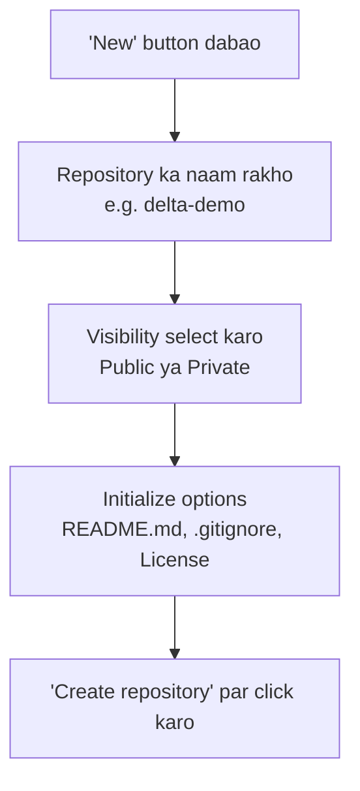
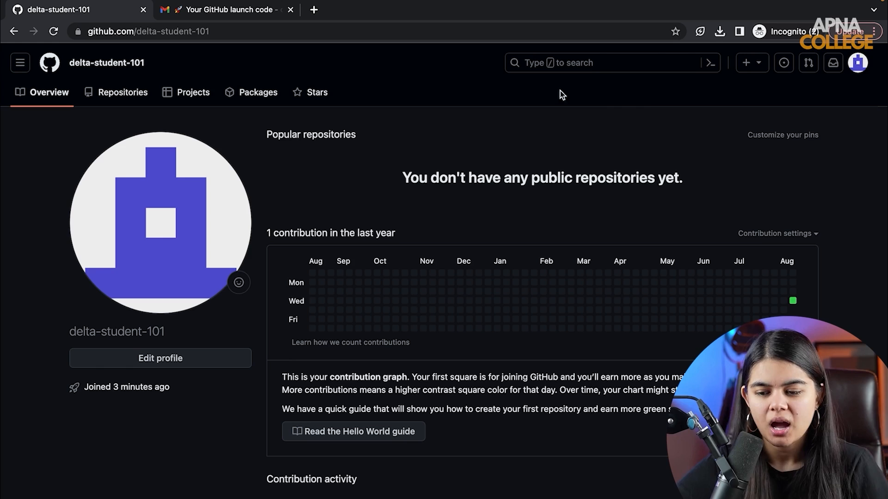

# Submodule 35.03: GitHub Web Interface aur Repositories (Hinglish)

## 1. GitHub Interface ka Structure

GitHub login karne ke baad aapko dashboard, profile, aur repositories ka complete overview milta hai.

### Zaroori Sections:
1. **Profile Page**:
   - **Bio & Pinned Repos**: Yahan aap apne 6 best projects ko showcase (pin) kar sakte ho.
   - **Contribution Heatmap**: Yeh green blocks ka calendar hota hai jo dikhata hai ki aapne saal ke kis din kitne commits kiye.
2. **Repositories Tab**: Yahan aapke saare projects (repos) ki list hoti hai.

---

## 2. Nayi Repository Kaise Banayein?

**Repository** (short mein **Repo**) ek folder ki tarah hoti hai jisme aapka pura project, files, images, aur unka complete revision history store hota hai.

### Options ka Matlab:
- **Repository Name**: Descriptive naam rakhein (jaise `delta-demo` ya `smartcart-clustering`).
- **Public vs Private**:
  - **Public**: Poori duniya aapka code dekh sakti hai. Portfolio aur open source ke liye public zaroori hai.
  - **Private**: Sirf aap aur aapke approved teammates hi dekh sakte hain.
- **Add a README file**: Yeh check karne se ek `README.md` file ban jati hai jisme project ka introduction likha jata hai.
- **Add .gitignore**: Yeh aisi files ki list hoti hai jinko Git track nahi karega (jaise passwords, virtual environments, heavy datasets).
- **Choose a License**: Code use karne ki legal terms (jaise MIT License).

---

## 3. Browser se File Edit aur Commit Karna

1. **File Edit**: GitHub par kisi bhi file par ja kar pencil icon par click karke direct browser mein code edit kar sakte hain.
2. **Commit Changes**:
   - Change karne ke baad neeche **Commit changes** ka button hota hai.
   - **Commit Message**: Ek chota title likhein jo bataye kya change kiya (jaise `Update README.md with project overview`).
   - **Commit directly to main**: Enter karte hi change repository ke history mein permanently save ho jata hai.
3. **Commit History**:
   - Commits par click karke aap dekh sakte ho kisne kab kya change kiya. Green color added lines dikhata hai aur Red color deleted lines dikhata hai.

---

## 4. Visual Reference

