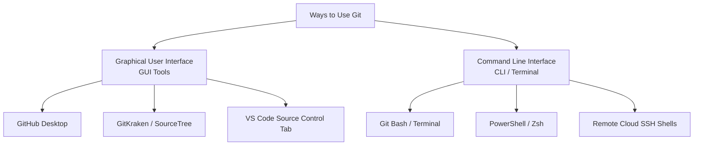

# Submodule 35.04: Using Git (CLI vs GUI Approaches)

## 1. Interaction Paradigms for Git

There are two primary paradigms for interacting with the Git version control system:



---

## 2. Why Developers Prefer the Command Line (CLI)

While GUI applications offer point-and-click convenience for beginners, professional software engineers and AI practitioners primarily operate via the terminal:

1. **Speed & Efficiency**: CLI commands execute instantly without the latency and memory overhead of heavy graphical wrappers.
2. **Unrestricted Feature Access**: GUI clients only expose a subset of Git features. Complex operations (e.g., interactive rebasing, selective patch staging, reflog recovery) are only possible via CLI.
3. **Universal Production Availability**: Remote cloud compute clusters, headless Linux GPU nodes, Docker containers, and CI/CD runners do not possess graphical desktop environments. CLI fluency is mandatory.
4. **Scriptability & Automation**: Terminal commands can be embedded into automated shell scripts and deployment pipelines.

---

## 3. Verifying Git Installation

To confirm that Git is properly installed and accessible via your system's PATH, open your terminal (Git Bash, macOS Terminal, or Linux Shell) and execute:

```bash
git --version
```

### Expected Output:
```text
git version 2.44.0.windows.1
```
*(The specific version number may vary depending on your installation).*

If the command returns `command not found`, ensure that Git is installed and that its binary path is added to your operating system's environment variables.
