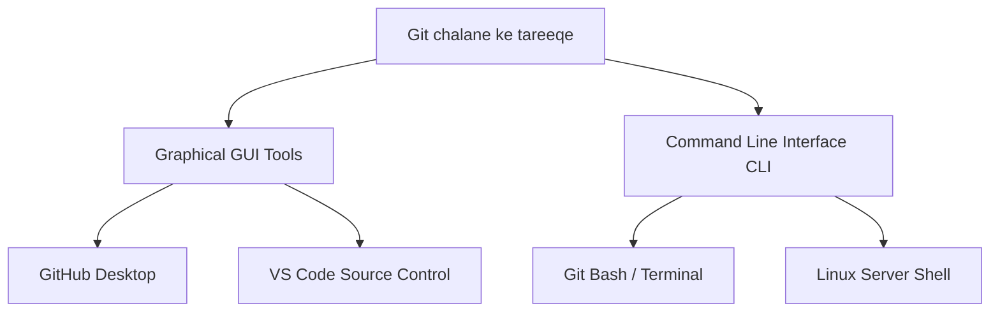
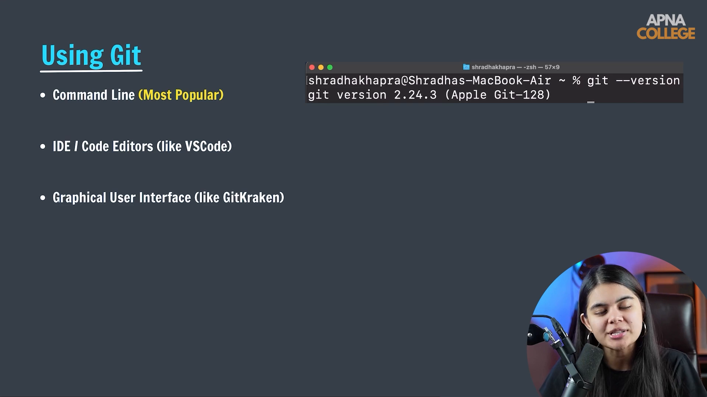

# Submodule 35.04: Git ko Use Karne ke Tareeqe (CLI vs GUI) (Hinglish)

## 1. Git ko Chalane ke Do Tareeqe

Git ke sath kaam karne ke do main methods hote hain:



---

## 2. Developers Terminal (CLI) kyun prefer karte hain?

Shuruaat mein GUI buttons aasan lag sakte hain, lekin industry mein sabhi senior engineers terminal hi use karte hain:

1. **Bohot Fast aur Lightweight**: Terminal commands bina kisi lag ya heavy application ke turant execute hoti hain.
2. **Saare Advanced Features Available**: GUI software mein sirf basic features hote hain, jabki complex recovery commands sirf terminal se hi chal sakti hain.
3. **Remote Servers par GUI nahi hota**: Jab aap AWS, Google Cloud, ya kisi high-end GPU server par model train kar rahe hote ho, toh wahan koi mouse ya screen nahi hoti—sirf terminal SSH hota hai.
4. **Automation**: Terminal commands ko scripts aur pipelines mein automate kiya ja sakta hai.

---

## 3. Git Installation Check Karna

Apne system mein Git check karne ke liye terminal kholiye aur command run kijiye:

```bash
git --version
```

### Terminal Output:
```text
git version 2.44.0.windows.1
```

Agar version number print ho raha hai, iska matlab Git successfully installed aur configure hai.

---

## 4. Visual Reference


