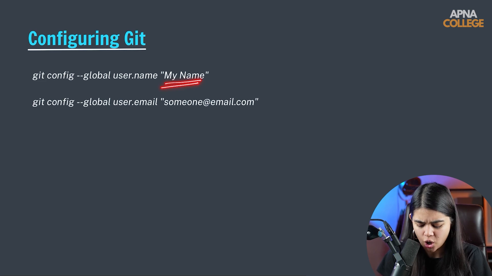

# Submodule 35.05: Git ko Configure Karna (Identity Setup) (Hinglish)

## 1. Identity Setup kyun zaroori hai?

Git par jab bhi aap koi commit (save-point) banate ho, toh Git us commit par author ka naam aur email permanently stamp kar deta hai. Isse team ko pata chalta hai ki kis developer ne kaunsa code likha hai.

Isliye pehli baar Git use karte waqt apni identity configure karna mandatory hota hai.

---

## 2. Git Configuration Commands

Apne pure computer ke liye globally identity set karne ke liye `--global` flag use karte hain:

### 1. Apna Naam Set Karein:
```bash
git config --global user.name "Aapka Naam"
```
*Example:*
```bash
git config --global user.name "Shivam Keshari"
```

### 2. Apni Email Set Karein:
```bash
git config --global user.email "aapki.email@example.com"
```
*Example:*
```bash
git config --global user.email "shivamkeshari@gmail.com"
```

> [!IMPORTANT]
> Dhyan rahe ki wahi email ID enter karein jo aapke GitHub account se linked hai. Tabhi GitHub aapke local commits ko aapke profile heatmap se connect kar payega.

---

## 3. Configuration Check Karna

Dekhne ke liye ki Git ne details sahi save ki hain ya nahi:

```bash
# Saari configurations list karein
git config --list

# Ya specific field check karein
git config user.name
git config user.email
```

---

## 4. Visual Reference


