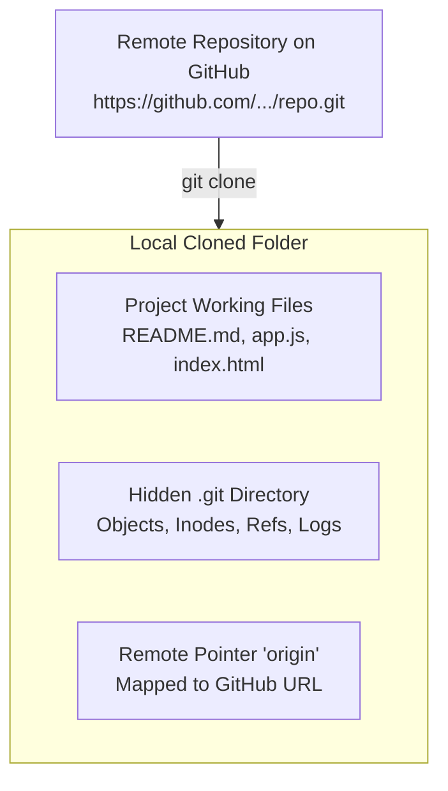

# Submodule 35.07: The Git Clone Command

## 1. What is Cloning?

**Cloning** is the process of creating an exact local copy of a remote Git repository on your physical computer. When you clone a repository, Git does not simply download the raw files; it downloads:
- All source code and assets.
- The complete commit history and log.
- All branches and tags.
- The hidden `.git/` directory containing all version control metadata.
- Automatically configures a remote reference named `origin` pointing back to the cloud repository URL.

---

## 2. Command Syntax & Usage

```bash
git clone <repository_url>
```

### Step-by-Step Cloning Workflow:
1. Navigate to the target repository on GitHub (e.g., `https://github.com/delta-student/delta-demo`).
2. Click the green **`<> Code`** button.
3. Copy the repository URL under the **HTTPS** tab (e.g., `https://github.com/delta-student/delta-demo.git`).
4. Open your terminal and navigate to the directory where you want the project folder created.
5. Execute the clone command:
   ```bash
   git clone https://github.com/delta-student/delta-demo.git
   ```
6. Enter the newly cloned directory:
   ```bash
   cd delta-demo
   ```

---

## 3. What Clone Does Behind the Scenes



### Verifying the Cloned Repository:
```bash
# Check contents (including hidden .git folder)
ls -la

# Verify configured remote URL
git remote -v
```

### Expected Output of `git remote -v`:
```text
origin  https://github.com/delta-student/delta-demo.git (fetch)
origin  https://github.com/delta-student/delta-demo.git (push)
```
