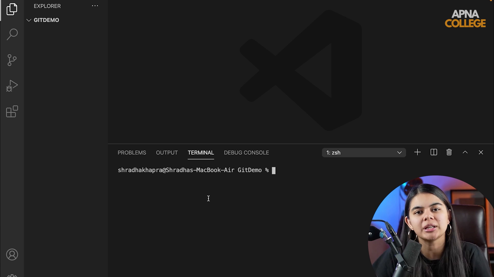

# Submodule 35.07: Git Clone Command (Hinglish)

## 1. Cloning kya hoti hai?

**Clone** ka matlab hota hai duplicate ya exact copy banana. Jab hum GitHub par bani kisi remote repository ko apne local computer par download karte hain, toh use **Cloning** kehte hain.

Cloning sirf files download nahi karti, balki:
- Project ki saari files aur folders laati hai.
- Pura commit history aur branches download karti hai.
- Ek hidden `.git/` folder banati hai jisme pura version control system hota hai.
- Automatically `origin` naam ka remote pointer set kar deti hai jo GitHub repo ko point karta hai.

---

## 2. Command Syntax aur Upyog

```bash
git clone <repository_url>
```

### Step-by-Step Workflow:
1. GitHub par project repository open karein.
2. Green color ke **`<> Code`** button par click karein.
3. **HTTPS** URL ko copy karein (jaise `https://github.com/delta-student/delta-demo.git`).
4. Terminal mein us folder mein jayein jahan project save karna hai.
5. Clone command run karein:
   ```bash
   git clone https://github.com/delta-student/delta-demo.git
   ```
6. Cloned folder ke andar enter karein:
   ```bash
   cd delta-demo
   ```

---

## 3. Clone hone ke baad verification

```bash
# Hidden files ke sath list karein
ls -la

# Check karein remote URL set hua ya nahi
git remote -v
```

### Terminal Output:
```text
origin  https://github.com/delta-student/delta-demo.git (fetch)
origin  https://github.com/delta-student/delta-demo.git (push)
```
Ab aapka local system cloud repository ke sath fully connected hai.

---

## 4. Visual Reference


