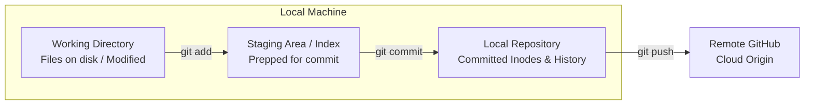

# Submodule 35.08: The Git Status Command & Architecture

## 1. The Three States of Git

To understand what `git status` reports, you must understand Git's three fundamental zones:



### The Postal Letter Analogy:
- **Working Directory**: Writing raw content on a sheet of paper at your desk. You can cross out words, make edits, or discard pages.
- **Staging Area (Index)**: Folding the paper, placing it into an envelope, and sealing it. You have explicitly selected which items are ready to be mailed.
- **Local Repository (Commit)**: Stamping the envelope with an official postal seal and depositing it into the collection box. It is now a permanent historical record.

---

## 2. Using `git status`

The `git status` command inspects your repository's working tree and staging area, providing a detailed breakdown of untracked, modified, and staged files.

```bash
git status
```

### Interpretation of Status Outputs:

1. **Untracked Files (Red text)**:
   - New files present in your directory that Git is not currently tracking.
   ```text
   Untracked files:
     (use "git add <file>..." to include in what will be committed)
           index.html
   ```
2. **Changes to be Committed / Staged (Green text)**:
   - Files that have been added to the staging area via `git add` and will be included in the next commit.
   ```text
   Changes to be committed:
     (use "git restore --staged <file>..." to unstage)
           new file:   index.html
   ```
3. **Changes Not Staged for Commit (Red text)**:
   - Previously tracked files that have been modified in the working directory since the last commit, but have not yet been added to the staging area.
   ```text
   Changes not staged for commit:
     (use "git add <file>..." to update what will be committed)
           modified:   README.md
   ```
4. **Clean Working Tree**:
   - Everything is committed and up to date with no pending changes.
   ```text
   nothing to commit, working tree clean
   ```

---

## 3. Visual Reference


