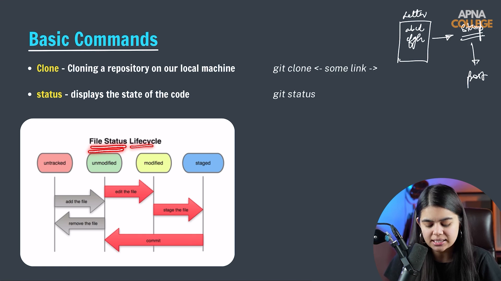

# Submodule 35.08: Git Status Command aur 3 States (Hinglish)

## 1. Git ki 3 Mukhya States

Git kaise kaam karta hai, ise samajhne ke liye uske 3 zones samajhna sabse zaroori hai:


### Post Office / Letter ka Classic Example:
- **Working Directory**: Table par baith kar kagaz par letter likhna. Abhi aap jo chahe edit ya cancel kar sakte ho.
- **Staging Area**: Letter ko envelope (lifafe) ke andar daal kar seal karna. Yeh tay ho gaya ki kaun-kaun se kagaz bhejne hain.
- **Local Repository (Commit)**: Envelope par post office ka official stamp lag jana aur mailbox mein dal jana. Ab yeh permanent record ban chuka hai.

---

## 2. `git status` Command ka Upyog

`git status` command repository ki current halat check karne ke liye use hoti hai:

```bash
git status
```

### Outputs ka Matlab:

1. **Untracked Files (Red color)**:
   - Nayi files jo Git ko dikh rahi hain par abhi track nahi ho rahi hain.
   ```text
   Untracked files:
           index.html
   ```
2. **Changes to be Committed (Green color)**:
   - Jo files `git add` karke staging area mein pahunch chuki hain aur agle commit ke liye taiyar hain.
   ```text
   Changes to be committed:
           new file:   index.html
   ```
3. **Changes not staged for commit (Red color)**:
   - Jo purani tracked files mein aapne naya code likha hai par abhi stage nahi kiya hai.
4. **Working tree clean**:
   - Sabhi changes commit ho chuke hain aur koi nayi file ya change pending nahi hai.

---

## 3. Visual Reference


