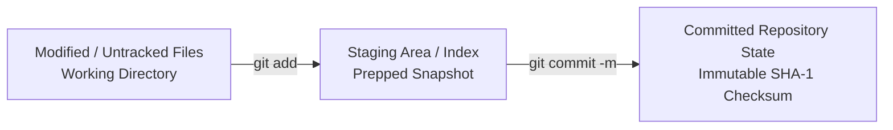

# Submodule 35.09: The Git Add & Commit Commands

## 1. The Two-Step Commit Workflow

Unlike simple "Save" operations in text editors, Git utilizes a deliberate **two-step commit process**:



This deliberate separation gives developers complete control over which modifications belong together in a logical, cohesive commit.

---

## 2. The `git add` Command (Staging)

The `git add` command moves changes from your Working Directory into the Staging Area:

```bash
# Stage a specific file
git add index.html

# Stage multiple specific files
git add app.js style.css

# Stage all modified and untracked files in the current project directory
git add .
```

> [!TIP]
> Always run `git status` before and after `git add` to verify exactly which files have transitioned into the green staging state.

---

## 3. The `git commit` Command (Recording Snapshots)

A **commit** permanently saves the staged snapshot into Git's internal database. Every commit possesses:
- A unique 40-character **SHA-1 hash** (e.g., `e082e89...`).
- Author name and email timestamped to the exact second.
- A concise **commit message** describing the nature of the update.

```bash
git commit -m "Descriptive commit message"
```

*Example:*
```bash
git commit -m "Add responsive navigation bar and user authentication form"
```

### Shortcut for Tracked Files (`-a -m`):
If files are already tracked by Git (i.e. not newly created files), you can combine staging and committing in a single command:
```bash
git commit -am "Update landing page typography"
```

### Best Practices for Commit Messages:
1. **Imperative Mood**: Write in the present tense (e.g., `Add user login`, not `Added user login`).
2. **Clear & Actionable**: Describe *what* and *why*, not just the line numbers.
3. **Atomic Commits**: Keep commits focused on a single logical change or bug fix.
