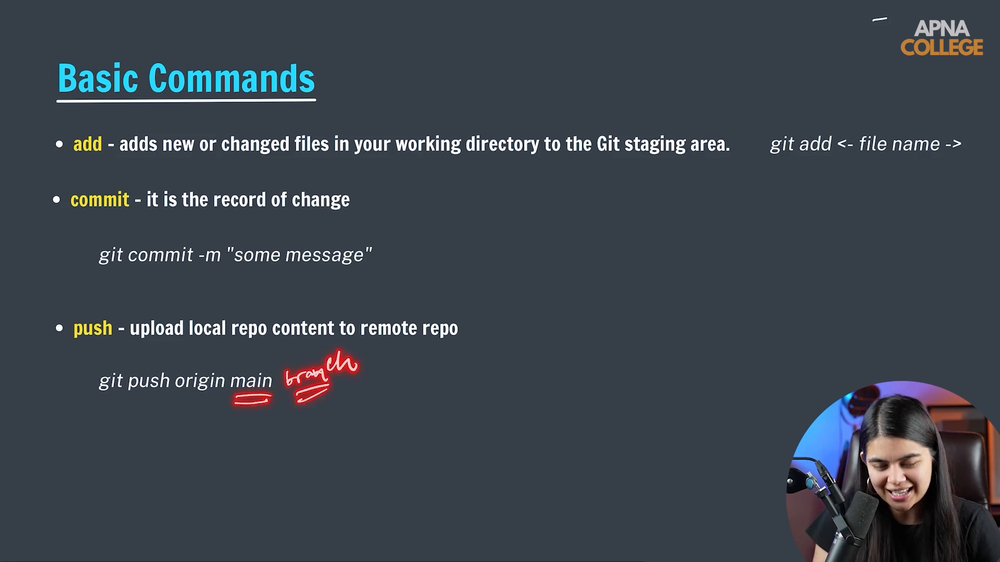

# Submodule 35.10: Git Push Command (Hinglish)

## 1. Pushing ka Matlab

`git commit` karne par aapka code sirf aapke apne computer ki hard drive par save hota hai. Use GitHub cloud par bhejne ke liye taaki sabhi team members dekh sakein aur code safe rahe, hum **Push** command ka use karte hain.


---

## 2. Command Syntax

```bash
git push origin main
```
- **`origin`**: GitHub repository ke URL ka standard nickname/alias hota hai.
- **`main`**: Wo branch jisme code transfer ho raha hai.

### Upstream Flag (`-u`):
Jab pehli baar kisi nayi repo mein push karte hain:
```bash
git push -u origin main
```
- `-u` flag aapke local branch aur GitHub ke remote branch ka aapas mein link set kar deta hai.
- Iske baad aapko baar-baar `origin main` nahi likhna padega; sirf `git push` likhne se kaam ho jayega.

---

## 3. Authentication (Login)

Pehli baar push karne par GitHub verification maangta hai:
- Modern systems par browser popup khulta hai jisme **Authorize GitCredentialManager** par click karte hi login ho jata hai.
- Password ki jagah **Personal Access Token (PAT)** use hota hai jo GitHub settings se generate hota hai.

---

## 4. Visual Reference


