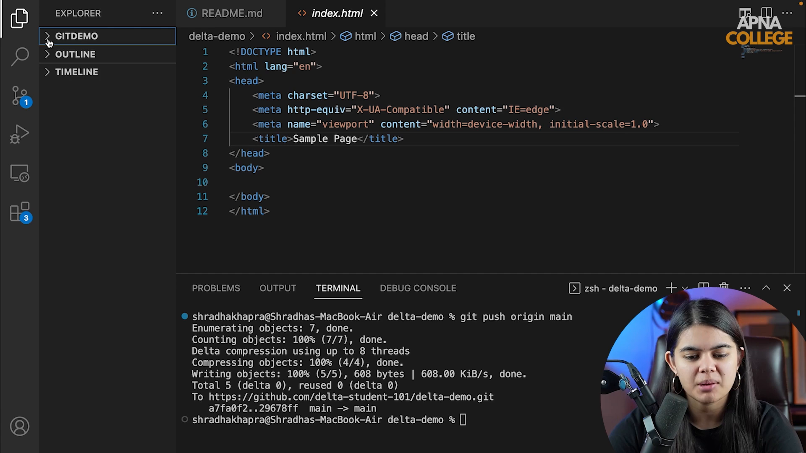

# Submodule 35.11: The Git Init Command

## 1. What is `git init`?

The `git init` command transforms an ordinary local directory into an active **Git Version Control repository**.

### Clone vs Init:
- **`git clone`**: Used when the project already exists on GitHub. You download the cloud repository onto your local computer.
- **`git init`**: Used when you are starting a new project locally from scratch on your computer and want to begin tracking version history before connecting it to GitHub.

---

## 2. Command Execution & Internal Anatomy

Open your terminal, navigate into your project folder, and run:

```bash
git init
```

### Expected Output:
```text
Initialized empty Git repository in C:/Users/Engineer/my_ml_project/.git/
```

### What Happens Behind the Scenes:
Git creates a hidden directory named `.git/` in the root of your project folder. This hidden folder contains Git's entire engine:
- **`objects/`**: Object store holding all file blobs, directory trees, and commit records.
- **`refs/`**: Pointers to local branches, remote tracking branches, and tags.
- **`HEAD`**: A pointer referencing your currently active branch (e.g., `ref: refs/heads/main`).
- **`config`**: Project-specific repository configuration settings.

> [!WARNING]
> Never manually delete or edit files inside `.git/` unless you are performing expert surgery. Deleting `.git/` destroys your entire version control history (though your raw project files remain intact).

---

## 3. Visual Reference


