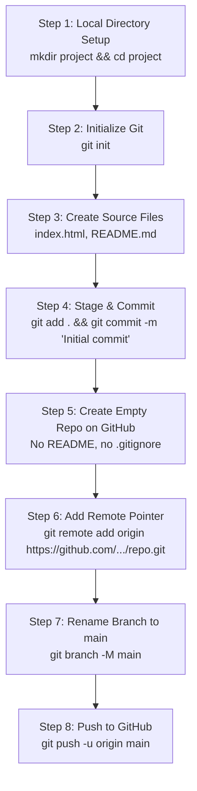
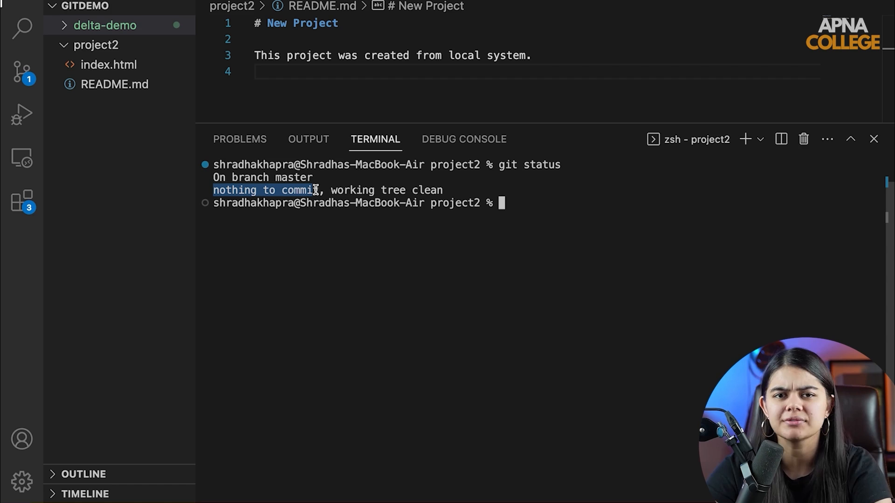

# Submodule 35.12: Pushing an Existing Local Repository to GitHub

## 1. End-to-End Workflow Architecture

Connecting an existing local project directory to a brand-new cloud repository on GitHub is one of the most common workflows in engineering.



---

## 2. Step-by-Step Command Walkthrough

### Step 1: Create Local Project & Initialize Git
```bash
mkdir project_ml
cd project_ml
git init
```

### Step 2: Create Files & Make Initial Commit
```bash
echo "# Project ML Pipeline" > README.md
touch index.html app.py
git add .
git commit -m "Initial commit with project scaffold"
```

### Step 3: Create an Empty Repository on GitHub
1. Go to `https://github.com/new`.
2. Enter the repository name (e.g., `project_ml`).
3. **Crucial**: Leave "Add a README file", "Add .gitignore", and "Choose a license" **UNCHECKED** (creating an empty remote repo avoids merge conflicts on initial push).
4. Click **Create repository**.

### Step 4: Link Local Repo to Remote GitHub URL
```bash
git remote add origin https://github.com/your-username/project_ml.git
```
- **Verification**: Run `git remote -v` to confirm `origin` is mapped correctly.

### Step 5: Set Default Branch Name to `main`
```bash
git branch -M main
```
- Older Git versions defaulted to naming the initial branch `master`. Modern industry standards use `main`. The `-M` flag renames the current branch to `main`.

### Step 6: Push Commits to GitHub
```bash
git push -u origin main
```
Your local files and complete commit history are now live on GitHub!

---

## 3. Visual Reference


