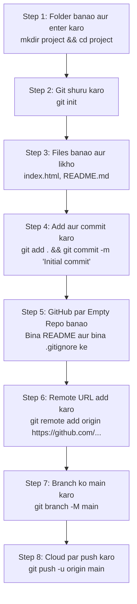

# Submodule 35.12: Local Repo ko GitHub par Push Karna (Hinglish)

## 1. Complete Workflow Diagram

Apne computer ke local project ko GitHub par naye repository ke sath connect karke push karne ka step-by-step tareeqa:



---

## 2. Step-by-Step Commands

### Step 1: Local Setup
```bash
mkdir project_ml
cd project_ml
git init
```

### Step 2: Files banakar Commit karein
```bash
touch index.html README.md
git add .
git commit -m "Initial commit"
```

### Step 3: GitHub par Empty Repo Banayein
- GitHub par **New repository** par jayein.
- Naam likhein aur **Add README** par tick **MAT** lagayein (taaki repo bilkul empty rahe).
- **Create repository** par click karein.

### Step 4: Remote URL Link Karein
GitHub par diye gaye 3 commands run karein:
```bash
# 1. Remote link connect karo
git remote add origin https://github.com/aapka-username/project_ml.git

# 2. Branch ka naam 'main' confirm karo
git branch -M main

# 3. Pura code push karo
git push -u origin main
```

Ab browser refresh karke dekhein, aapka pura code GitHub par live ho chuka hoga!
