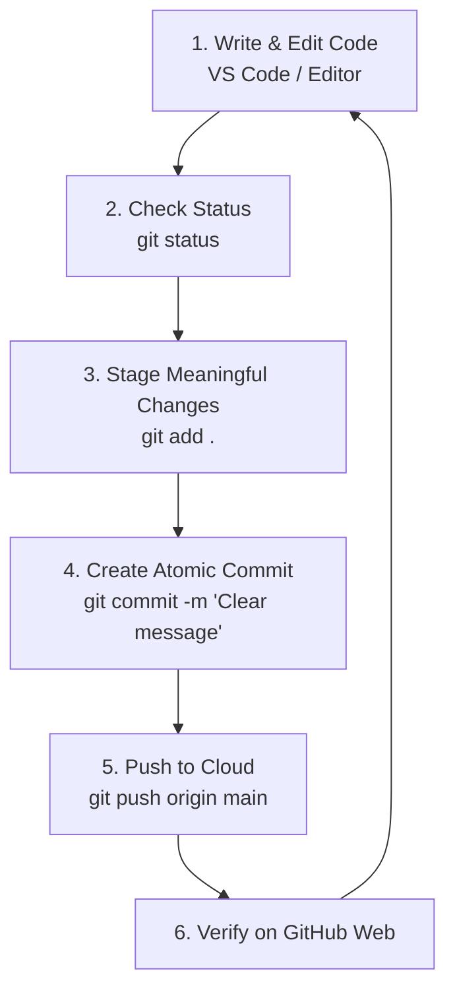

# Submodule 35.13: The Standard Engineering Git Workflow

## 1. The Daily Development Cycle

Whether building machine learning models, REST APIs, or frontend interfaces, developers execute the exact same core Git lifecycle daily:

---

## 2. Step-by-Step Operational Protocol

1. **Modify / Create Code**:
   - Write functions, update models, refactor modules in your editor.
2. **Review Working State (`git status`)**:
   - Identify which files were changed and ensure no unwanted temporary files or secrets are present.
3. **Stage Changes (`git add .`)**:
   - Group related updates into the staging index.
4. **Record Milestone (`git commit -m "..."`)**:
   - Save the snapshot with an informative message.
5. **Synchronize (`git push origin main`)**:
   - Upload local progress to the remote GitHub cloud repository.

---

## 3. Core Golden Rules
- **Commit Frequently**: Small, focused commits are easier to debug, review, and revert than massive, monolithic changes.
- **Never Commit Secrets**: Never commit API keys, database passwords, or private environment files (`.env`).
- **Push at End of Day**: Always push your work to remote before shutting down to prevent data loss.

---

## 4. Visual Reference

