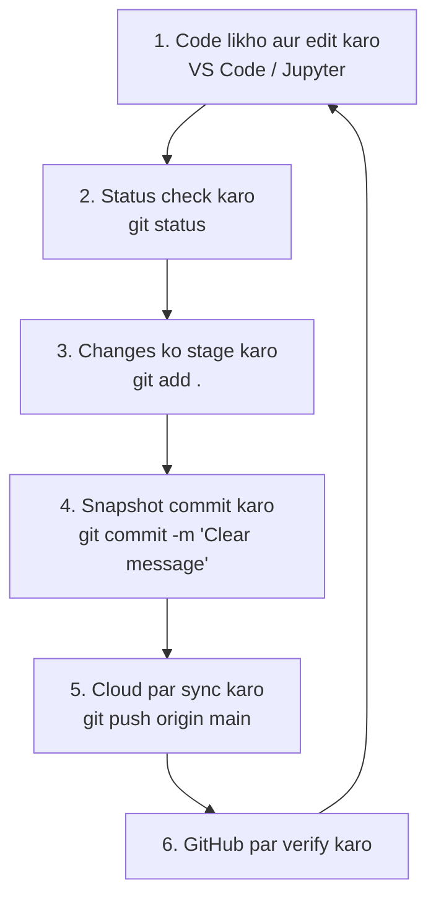
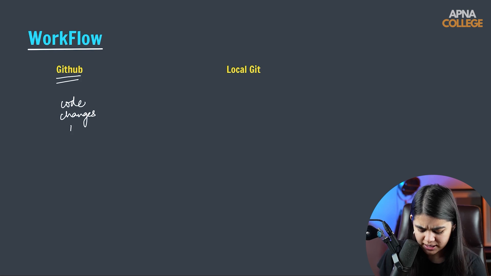

# Submodule 35.13: Standard Git Workflow (Hinglish)

## 1. Daily Development Cycle

Software aur AI development mein har developer daily yeh standard cycle follow karta hai:

---

## 2. Kaam Karne ka Standard Tarika

1. **Code Likhein**: Naye features implement karein ya bug fix karein.
2. **Status Check**: `git status` chala kar dekhein ki kaunsi files change hui hain.
3. **Stage**: `git add .` se un files ko pack karein.
4. **Commit**: `git commit -m "..."` se meaningful message ke sath save karein.
5. **Push**: `git push origin main` se GitHub par upload kar dein.

---

## 3. Golden Rules
- **Chote-Chote Commits**: Har ek feature ya fix ka alag commit banayein taaki roll back karna aasan ho.
- **Passwords Kabhi Commit Na Karein**: API keys aur sensitive passwords ko kabhi Git mein add na karein.
- **Roz Push Karein**: Din khatam hone par hamesha code GitHub par push karein taaki backup safe rahe.

---

## 4. Visual Reference

