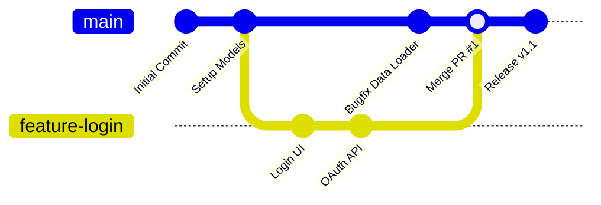

# Submodule 35.14: Git Branches (Concepts & Architecture)

## 1. What is a Git Branch?

A **Branch** in Git is an independent, isolated line of development. Internally, a branch is simply a lightweight, movable pointer pointing to a specific commit in your repository's commit graph.

### The Default Branch:
When you initialize a repository, Git creates a default primary branch—conventionally named **`main`** (historically `master`). The `main` branch represents stable, deployable production code.

---

## 2. Why is Branching Critical in Engineering?

In collaborative environments, multiple engineers work on different features simultaneously:
- **Developer A**: Building a new payment gateway.
- **Developer B**: Redesigning the landing page UI.
- **Developer C**: Fixing a critical database query bug.

If all three developers committed directly to the `main` branch, unfinished and untested code would break production for everyone.

### Key Advantages of Branching:
1. **Total Isolation**: Experimental code on a feature branch cannot corrupt or break the stable `main` branch.
2. **Parallel Team Development**: Multiple engineers develop separate features simultaneously without blocking each other.
3. **Controlled Integration**: Changes are merged into `main` only after passing rigorous automated testing and peer code reviews via Pull Requests.
