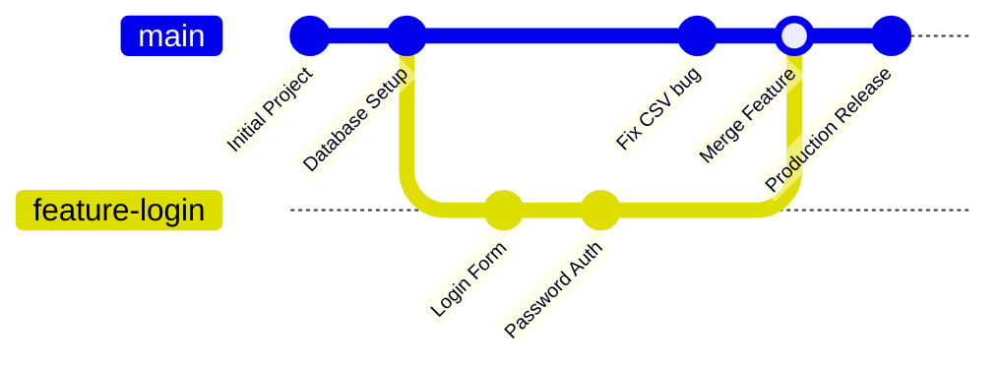

# Submodule 35.14: Git Branches (Concepts & Architecture) (Hinglish)

## 1. Branch kya hoti hai?

Git mein **Branch** ek independent line of development hoti hai. Asal mein branch ek halka-phulka movable pointer hota hai jo specific commit ko point karta hai.

### Default Branch (`main`):
Jab bhi naya repo banta hai, toh Git ek default branch banata hai jiska naam **`main`** (pehle `master`) hota hai. Yeh branch hamesha stable, working production code ko represent karti hai.

---

## 2. Branching kyun itni zaroori hai?

Real-world team project mein ek sath kayi developers kaam karte hain:
- Ek developer naya payment feature bana raha hai.
- Doosra developer user profile page design kar raha hai.
- Teesri developer database bug fix kar rahi hai.

Agar sabhi log directly `main` branch mein adha-adhura code daalte rahenge, toh pura application crash ho jayega.

### Branching ke Mukhya Fayde:
1. **Safety aur Isolation**: Jab tak naya feature pura ban kar test na ho jaye, tab tak wo alag branch mein rehta hai aur main code safe rehta hai.
2. **Parallel Kaam**: Har developer apni branch mein bina kisi tension ke naya code experiment kar sakta hai.
3. **Code Review**: Feature complete hone ke baad hi team use review karke main branch mein merge karti hai.
