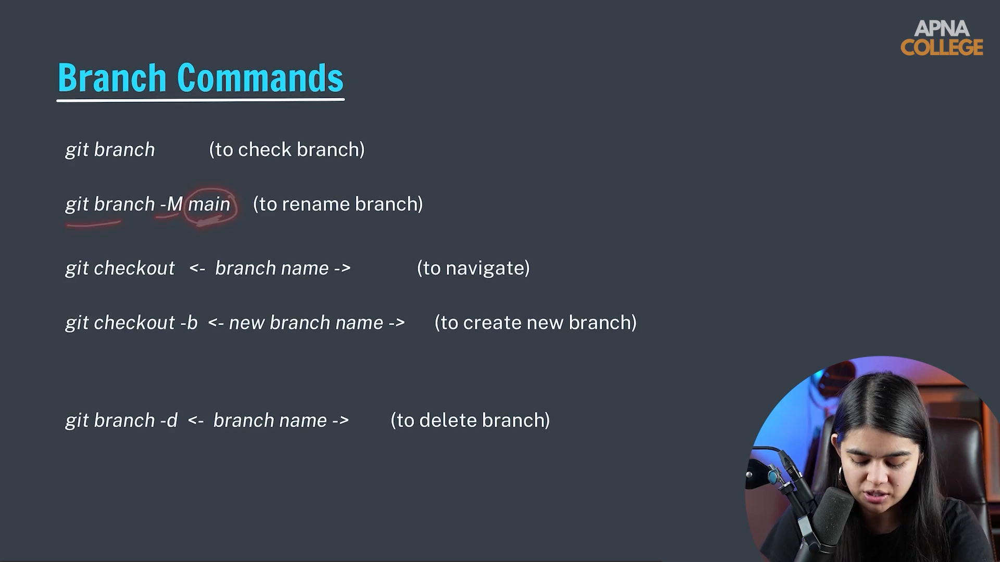

# Submodule 35.15: Branch Commands & Management

## 1. Overview of Branching Operations

Git provides a comprehensive command suite to inspect, create, switch, rename, and delete branches safely.

---

## 2. Essential Branch Commands

### 1. Listing All Branches:
```bash
git branch
```
- Lists all local branches in the repository.
- An asterisk (`*`) and green text indicates your currently active (checked out) branch.
```text
* main
  feature-auth
  bugfix-dataset
```

### 2. Creating a New Branch:
```bash
git branch <branch_name>
```
*Example:*
```bash
git branch feature-login
```
*(Creates the branch pointer at the current commit without switching to it).*

### 3. Switching Between Branches (`checkout` vs `switch`):
```bash
# Classic command
git checkout feature-login

# Modern Git command (Git 2.23+)
git switch feature-login
```
- Updates files in your working directory to match the snapshot of the target branch.
- Moves the `HEAD` pointer to `feature-login`.

### 4. Create and Switch in One Step:
```bash
# Classic shortcut
git checkout -b feature-login

# Modern shortcut
git switch -c feature-login
```

### 5. Renaming a Branch:
```bash
# Rename currently active branch
git branch -M main

# Rename specific branch
git branch -m old_name new_name
```

### 6. Deleting a Branch:
```bash
# Safe deletion (aborts if branch has unmerged commits)
git branch -d feature-login

# Force deletion (deletes branch regardless of merge status)
git branch -D feature-login
```

> [!CAUTION]
> You cannot delete a branch that you are currently standing on. Always checkout to another branch (e.g. `main`) before executing `git branch -d`.

---

## 3. Visual Reference


