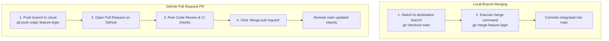

# Submodule 35.16: Merging Branches & GitHub Pull Requests

## 1. What is Branch Merging?

**Merging** combines the independent commit history of one branch into another. Typically, once a feature or bugfix is completed and verified on a `feature` branch, it is merged into the primary `main` branch.



---

## 2. Local Branch Merge Workflow

Suppose you built a new file `app.js` inside `feature-button`:
1. **Switch to Target Branch**:
   ```bash
   git checkout main
   ```
2. **Execute Merge**:
   ```bash
   git merge feature-button
   ```
3. **Inspect History**:
   ```bash
   git log --oneline
   ```
4. **Delete Obsolete Branch**:
   ```bash
   git branch -d feature-button
   ```

---

## 3. The Professional GitHub Pull Request (PR) Workflow

In engineering teams, developers do not merge branches locally and push directly to `main`. Instead, they follow the **Pull Request** model:

1. **Push Feature Branch to Remote**:
   ```bash
   git push origin feature-button
   ```
2. **Open Pull Request on GitHub**:
   - Go to your repository on GitHub.
   - Click the prominent yellow button: **Compare & pull request**.
3. **Describe Changes**:
   - Set base branch to `main` and compare branch to `feature-button`.
   - Add a descriptive title and bullet points outlining the implementation.
4. **Code Review & Automated Tests**:
   - Team members review line-by-line diffs, leave comments, and suggest improvements.
   - CI/CD pipelines run automated unit tests.
5. **Merge PR**:
   - Click **Merge pull request** $	o$ **Confirm merge**.
   - Click **Delete branch** on GitHub to keep remote tidy.
6. **Sync Local Machine**:
   ```bash
   git checkout main
   git pull origin main
   ```
