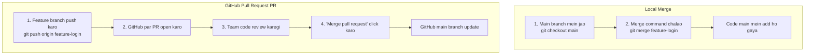

# Submodule 35.16: Branches ko Merge Karna aur Pull Requests (Hinglish)

## 1. Branch Merge kya hota hai?

Jab aapka feature ya bugfix branch mein complete ho jata hai, toh uske code ko wapas primary **`main`** branch mein jodna **Merge** kehlata hai.



---

## 2. Local System par Merge Karna

Maan lo aapne `feature-button` branch mein `app.js` banayi:
1. Pehle `main` branch mein wapas aao:
   ```bash
   git checkout main
   ```
2. Feature branch ko merge karo:
   ```bash
   git merge feature-button
   ```
3. Purani branch delete kar do:
   ```bash
   git branch -d feature-button
   ```

---

## 3. Industry Standard: GitHub Pull Request (PR)

Company mein developers direct main branch mein merge nahi karte. **Pull Request (PR)** open karte hain:

1. **Branch Push Karein**:
   ```bash
   git push origin feature-button
   ```
2. **GitHub par PR Banayein**:
   - GitHub par yellow banner dikhega: **Compare & pull request**. Us par click karein.
   - Likhein ki aapne kya code change kiya hai.
3. **Code Review**:
   - Senior developers aur team members code review karte hain.
4. **Merge**:
   - Green button **Merge pull request** dabate hi code cloud ki main branch mein jud jata hai.
5. **Local Update**:
   ```bash
   git checkout main
   git pull origin main
   ```
