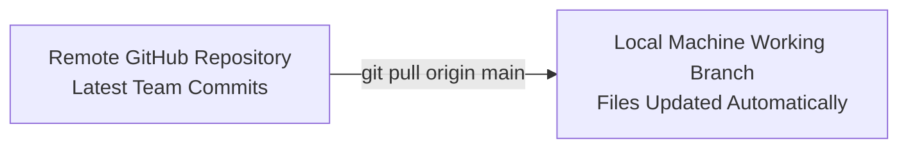
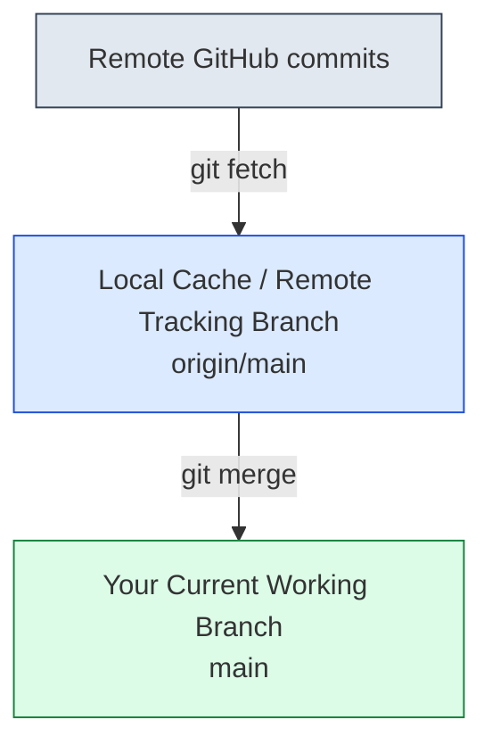

# Submodule 35.17: The Git Pull Command

## 1. What is Pulling?

The `git pull` command downloads commits from a remote GitHub repository and instantly integrates (merges) them into your currently checked out local branch.



---

## 2. Command Syntax & Common Scenarios

```bash
git pull origin main
```

### Typical Use Cases:
1. **Starting Your Work Day**: Always run `git pull` in the morning to incorporate code merged by teammates while you were offline.
2. **Post-PR Merges**: After merging a Pull Request on GitHub web, pull changes locally so your local `main` matches the remote `main`.
3. **Multi-Machine Development**: Syncing work between your office workstation and personal laptop.

---

## 3. `git fetch` vs `git pull`

It is important to understand what `git pull` does under the hood:



$$	ext{git pull} = 	ext{git fetch} + 	ext{git merge}$$

- **`git fetch`**: Downloads commits and branch updates from GitHub without altering your working files. It is 100% safe to run anytime.
- **`git pull`**: Automatically executes `git fetch` followed immediately by `git merge`. If conflicts exist between remote and local changes, Git flags a merge conflict.
