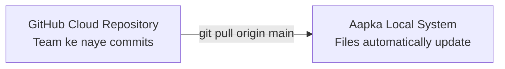

# Submodule 35.17: Git Pull Command (Hinglish)

## 1. Pulling ka Matlab

`git pull` command remote GitHub repository se naye commits download karke seedhe aapki local branch mein merge (integrate) kar deti hai.



---

## 2. Command Syntax

```bash
git pull origin main
```

### Pull kab-kab chalana chahiye?
1. **Subah kaam shuru karte waqt**: Hamesha pehle `git pull` karein taaki team members ka likha naya code aapke paas aa jaye.
2. **GitHub par PR merge karne ke baad**: Cloud ka naya code local machine par laane ke liye.
3. **Do computer par kaam karte waqt**: Laptop se push kiya, PC par aakar pull kar liya.

---

## 3. `git fetch` aur `git pull` ka Difference

$$	ext{git pull} = 	ext{git fetch} + 	ext{git merge}$$

- **`git fetch`**: Sirf GitHub se data download karke memory mein rakhta hai, aapki chal rahi files ko bilkul touch nahi karta (100% safe).
- **`git pull`**: Download bhi karta hai aur sath hi sath aapke local folder ke files ko update (merge) bhi kar deta hai.
