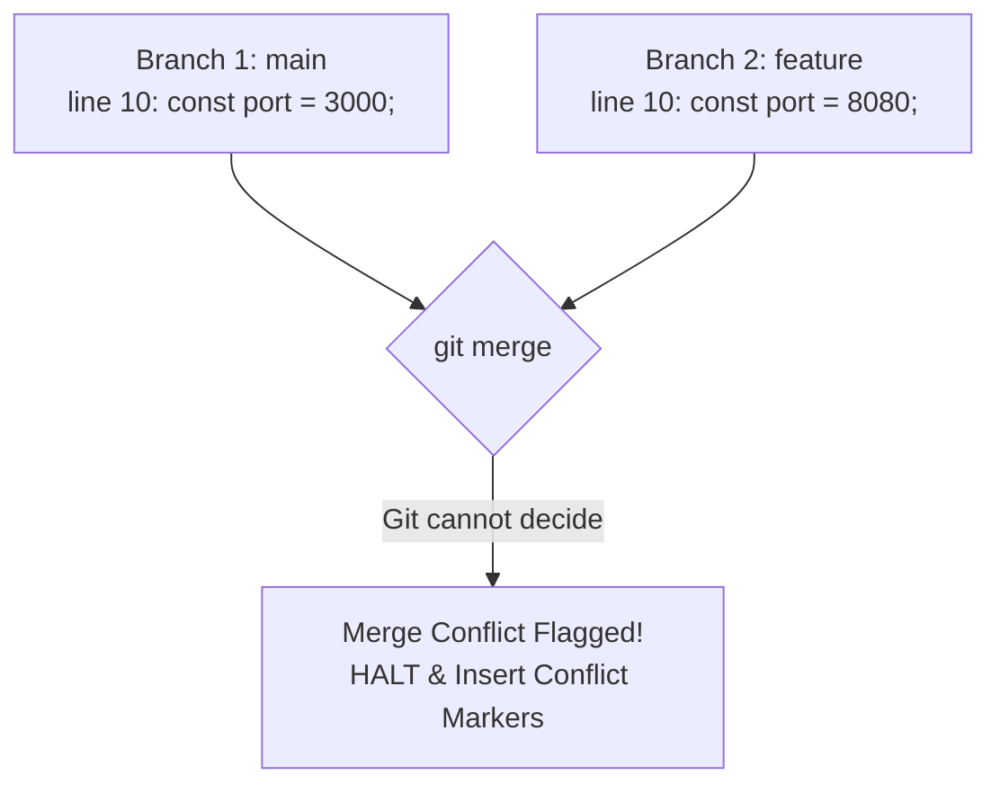

# Submodule 35.18: Resolving Merge Conflicts

## 1. What is a Merge Conflict?

A **Merge Conflict** is an event that occurs when Git is unable to automatically resolve differences in code between two commits during a merge or pull operation.

### When do Conflicts Happen?
Conflicts happen when two separate branches modify the **exact same line(s)** of the same file in different ways, or when one branch deletes a file that another branch modified. Because Git does not possess business logic to guess which developer's version is correct, it halts the merge and requests human intervention.



---

## 2. Understanding Git Conflict Markers

When a conflict occurs, Git modifies the affected file by wrapping the disputed lines in special **conflict markers**:

```javascript
<<<<<<< HEAD
const PORT = 3000; // Local / Current branch changes
=======
const PORT = 8080; // Incoming branch changes from feature/remote
>>>>>>> feature-config
```

### Breakdown of Markers:
- `<<<<<<< HEAD`: Marks the start of changes on your currently checked-out branch.
- `=======`: The separator dividing the two competing versions.
- `>>>>>>> branch_name`: Marks the end of changes on the incoming branch.

---

## 3. Step-by-Step Resolution Protocol

1. **Identify Conflicted Files**:
   Run `git status`. Conflicted files appear under `Unmerged paths: both modified`.
2. **Open the File in Editor**:
   In VS Code, conflict regions are highlighted with interactive buttons:
   - *Accept Current Change* (Keeps `HEAD`)
   - *Accept Incoming Change* (Keeps feature/remote)
   - *Accept Both Changes* (Keeps both)
3. **Manual Resolution**:
   Decide the correct business logic. Edit the lines and **completely delete all marker lines** (`<<<<<<<`, `=======`, `>>>>>>>`).
4. **Stage the Resolved File**:
   ```bash
   git add <conflicted_file>
   ```
5. **Complete the Merge Commit**:
   ```bash
   git commit -m "Resolve merge conflict in port configuration"
   ```
6. **Push Changes**:
   ```bash
   git push origin main
   ```
