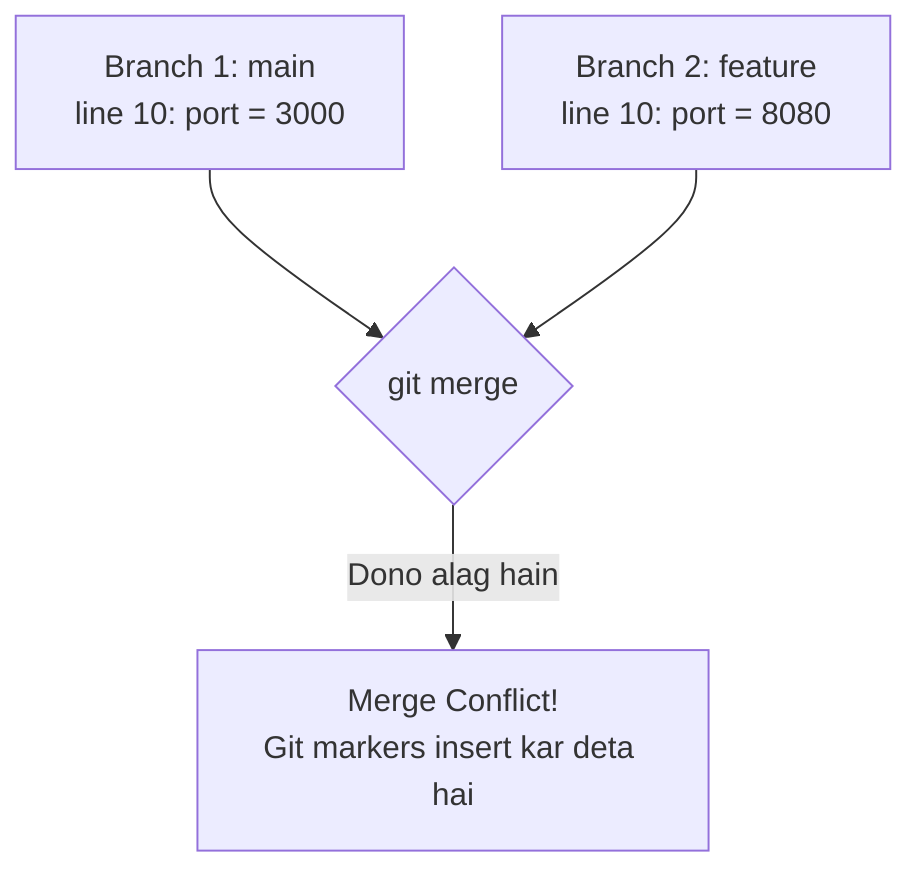
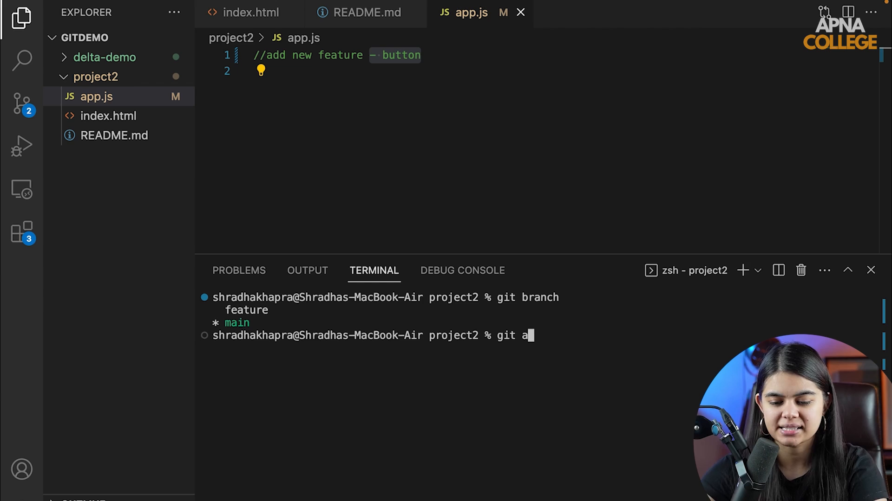

# Submodule 35.18: Merge Conflicts ko Resolve Karna (Hinglish)

## 1. Merge Conflict kya hota hai?

Jab Git do branches ko aapas mein merge kar raha hota hai aur dono branches ne **ek hi file ki same line** par alag-alag code likh diya ho, toh Git confuse ho jata hai ki kaunsa code sahi hai aur kaunsa galat.

Aise waqt par Git merge ko rok deta hai aur developer se kehta hai ki manually decide karo. Ise **Merge Conflict** kehte hain.



---

## 2. Git Conflict Markers ka Structure

Git file ke andar automatically teen special symbols laga deta hai:

```javascript
<<<<<<< HEAD
const PORT = 3000; // Aapka current branch ka code
=======
const PORT = 8080; // Doosri branch ka incoming code
>>>>>>> feature-config
```

- `<<<<<<< HEAD`: Aapki current branch ka code yahan se shuru hota hai.
- `=======`: Dono codes ke beech ka divider hai.
- `>>>>>>>`: Doosri branch ka code yahan khatam hota hai.

---

## 3. Conflict Solve Karne ka Tarika

1. **Status Dekhein**: `git status` chalayein, jo files conflict mein hain wo red color mein dikhengi.
2. **VS Code mein File Kholein**: VS Code mein buttons dikhte hain:
   - *Accept Current Change* (Apna code rakho)
   - *Accept Incoming Change* (Doosre ka code rakho)
   - *Accept Both* (Dono rakho)
3. **Markers Delete Karein**: Jo sahi code hai wo rakhein aur `<<<<<<<`, `=======`, `>>>>>>>` wali lines ko delete kar dein.
4. **Stage Karein**:
   ```bash
   git add <file_name>
   ```
5. **Commit Karein**:
   ```bash
   git commit -m "Resolve merge conflict in app.js"
   ```
6. **Push Karein**: `git push origin main`.

---

## 4. Visual Reference


