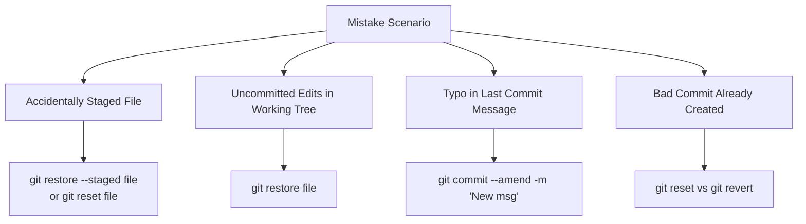

# Submodule 35.19: Fixing Mistakes (Undo, Reset, Revert)

## 1. Common Developer Errors in Git

Mistakes are an unavoidable aspect of software engineering. Git provides powerful mechanisms to undo errors at every stage of the lifecycle:



---

## 2. Fixing Staging & Working Tree Mistakes

### 1. Unstaging an Accidental File (Staged $	o$ Working Tree):
If you accidentally ran `git add secret_password.txt`:
```bash
# Modern command
git restore --staged secret_password.txt

# Classic command
git reset HEAD secret_password.txt
```
*(The file remains on disk with your edits intact, but transitions back to the red untracked/modified state).*

### 2. Discarding Uncommitted Edits in Working Tree:
If you modified a file and want to discard all changes, restoring it to the last commit's state:
```bash
# Modern command
git restore app.js

# Classic command
git checkout -- app.js
```
> [!WARNING]
> Discarding working tree edits is permanent and cannot be undone.

---

## 3. Fixing Commit Mistakes

### 1. Amending the Last Commit:
If you committed and forgot to include a file, or made a typo in the commit message:
```bash
# Fix message only
git commit --amend -m "Corrected commit message"

# Add forgotten file to last commit
git add forgotten_file.py
git commit --amend --no-edit
```

### 2. Undoing Commits: `git revert` vs `git reset`

| Command | Mechanism | History Impact | Production Safety |
| :--- | :--- | :--- | :--- |
| **`git revert <commit_hash>`** | Creates a **new commit** that mathematically inverts the changes of the specified commit. | Preserves full linear history. | **100% Safe** for shared/public branches on GitHub. |
| **`git reset HEAD~1`** | Rewinds the `HEAD` pointer backwards, removing the commit from history. | Rewrites commit history. | Dangerous on public branches; use only for private local commits. |

### The Three Modes of `git reset`:
1. **`git reset --soft HEAD~1`**: Removes the commit, but keeps changes staged in the index (ready to re-commit).
2. **`git reset --mixed HEAD~1`** *(default)*: Removes the commit and unstages changes, keeping modifications in your working directory.
3. **`git reset --hard HEAD~1`**: Completely obliterates the commit and wipes out all file modifications on disk.
