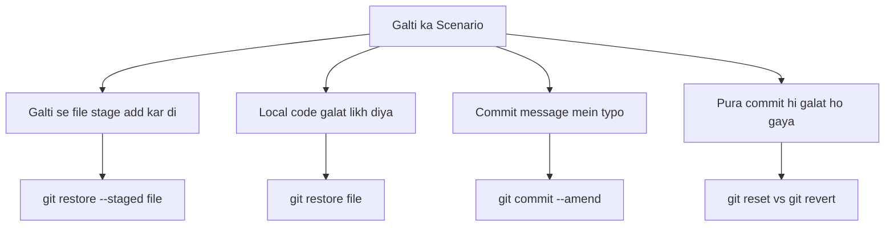
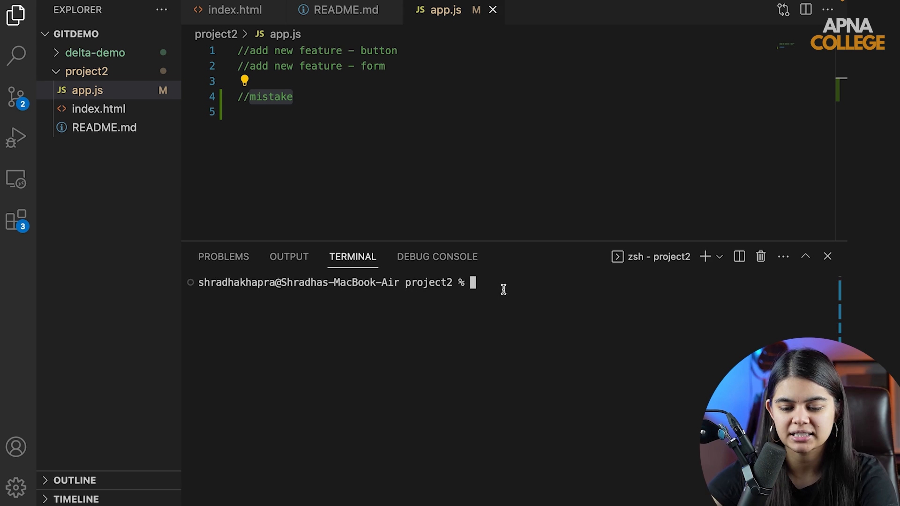

# Submodule 35.19: Galtiyan Sudharna (Reset, Revert, Undo) (Hinglish)

## 1. Git mein Galtiyan Theek Karna

Kaam karte waqt galtiyan hona aam baat hai. Git mein har level par galti undo karne ka tareeqa hota hai:



---

## 2. Add aur Modify ko Undo Karna

### 1. File ko Unstage Karna (Add Cancel Karna):
Agar galti se `git add secret.txt` kar diya:
```bash
git restore --staged secret.txt
# Ya purana tarika:
git reset HEAD secret.txt
```
File ka content delete nahi hoga, sirf green staging area se nikal kar wapas red normal state mein aa jayegi.

### 2. Apne Local Changes Discard Karna:
Agar aapne kisi file mein kuch galat likh diya aur aap chahte ho ki pichle commit jaisa ban jaye:
```bash
git restore app.js
```

---

## 3. Commit ko Theek Karna

### 1. Pichle Commit ka Message Badlna (`--amend`):
```bash
git commit --amend -m "Naya sahi commit message"
```

### 2. `git revert` vs `git reset`

- **`git revert <commit_hash>`**:
  - Yeh puraane galat commit ko delete nahi karta, balki ek naya commit banata hai jo us pichli galti ko cancel karta hai.
  - Team aur GitHub ke liye **100% safe** hai.
- **`git reset HEAD~1`**:
  - Yeh pichle commit ko history se gayab kar deta hai.
  - `--soft`: Commit gayab hoga par code staging area mein bacha rahega.
  - `--hard`: Commit aur code dono permanently gayab ho jayenge (dhyan se use karein).

---

## 4. Visual Reference


