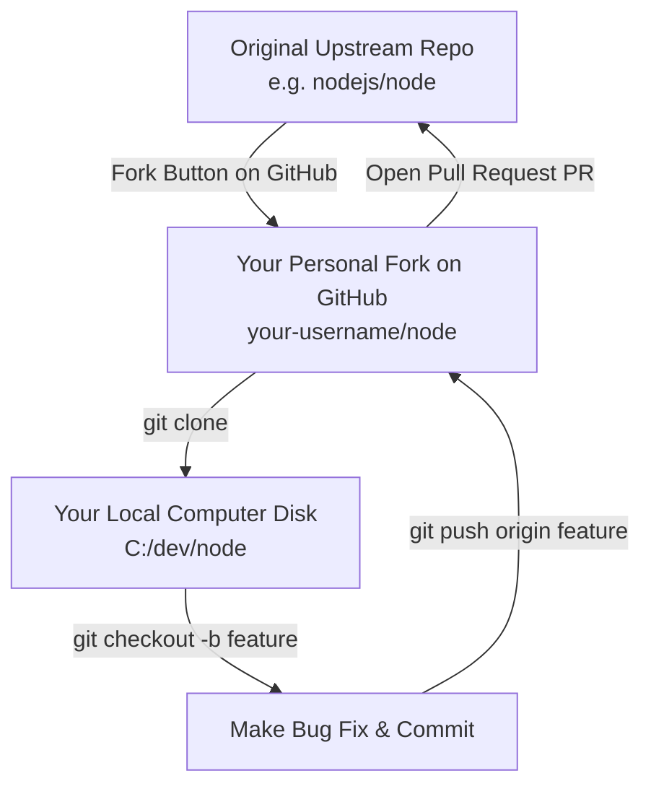

# Submodule 35.20: What is Forking & Open Source Contribution

## 1. What is Forking?

A **Fork** is a complete, independent copy of another user's or organization's GitHub repository created directly inside your personal GitHub account on GitHub's cloud servers.

### Fork vs Clone:
- **Clone**: Copies a repository from GitHub down to your local physical computer (`github.com` $	o$ Local Machine).
- **Fork**: Copies a repository from someone else's GitHub account to your personal GitHub account (`github.com/upstream/repo` $	o$ `github.com/your-username/repo`).



---

## 2. Why Fork a Repository?

1. **Lack of Direct Write Access**: Open-source repositories (e.g., PyTorch, React, Linux) do not grant direct write/push access to random developers. Forking allows you to experiment freely in your own copy.
2. **Proposing Contributions (Pull Requests)**: Once you implement a bug fix or feature in your fork, you can open a PR to suggest merging your changes back into the original project.
3. **Starting a Derivative Project**: Taking an existing open-source project and expanding it into a new independent product.

---

## 3. The 6-Step Open Source Contribution Protocol

1. **Fork**: Navigate to the target repository on GitHub and click the **Fork** button (top-right).
2. **Clone Your Fork**:
   ```bash
   git clone https://github.com/your-username/repo.git
   cd repo
   ```
3. **Create Feature Branch**:
   ```bash
   git checkout -b fix-memory-leak
   ```
4. **Implement & Commit**:
   ```bash
   git add .
   git commit -m "Resolve memory leak in buffer allocation"
   ```
5. **Push to Your Fork**:
   ```bash
   git push origin fix-memory-leak
   ```
6. **Open Pull Request**:
   - Go to the original upstream repository on GitHub.
   - Click **New Pull Request** $	o$ compare across forks $	o$ submit for project maintainer review.
