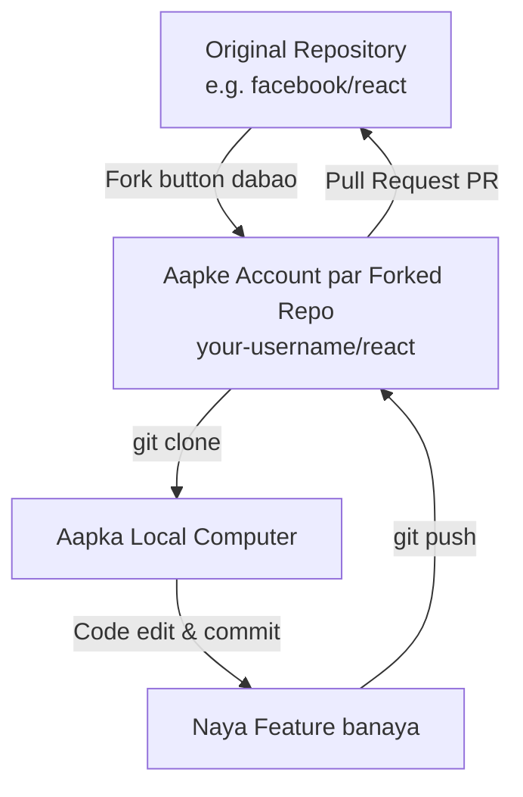
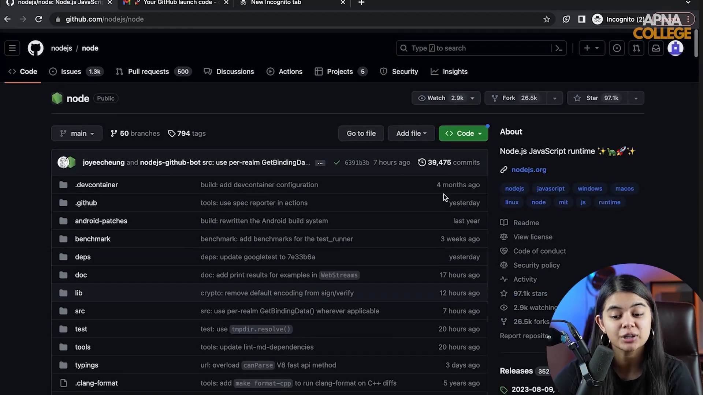

# Submodule 35.20: Forking aur Open Source Contribution (Hinglish)

## 1. Forking kya hoti hai?

**Fork** ka matlab hota hai kisi doosre developer ya organization ki GitHub repository ki ek complete copy apne khud ke personal GitHub account par bana lena.

### Fork aur Clone ka Farak:
- **Clone**: GitHub se code ko apne computer ki hard drive par download karna.
- **Fork**: Kisi doosre ke GitHub account se repository ko apne GitHub account par copy karna.



---

## 2. Forking kyun karte hain?

1. **Push Access Na Hona**: Duniya bhar ke bade open source projects (jaise Python, PyTorch) par koi bhi direct code push nahi kar sakta. Isliye pehle fork karke apne account par laate hain.
2. **Open Source Contribution**: Apne fork mein changes karke aap original creator ko Pull Request bhej sakte ho ki "Maine yeh bug fix kiya hai, aap apne code mein merge kar lo".

---

## 3. Open Source Contribution ke 6 Steps

1. **Fork Karein**: GitHub par repo par ja kar top-right mein **Fork** par click karein.
2. **Clone Karein**: Apne account wali forked repo ko computer par clone karein:
   ```bash
   git clone https://github.com/aapka-username/repo.git
   cd repo
   ```
3. **Nayi Branch Banayein**:
   ```bash
   git checkout -b fix-bug
   ```
4. **Code Sudharein aur Commit Karein**:
   ```bash
   git add .
   git commit -m "Fix calculation bug in data preprocessor"
   ```
5. **Apne Fork par Push Karein**:
   ```bash
   git push origin fix-bug
   ```
6. **Pull Request (PR) Bhejein**: Original repo par ja kar **Contribute / Open Pull Request** par click karein.

---

## 4. Visual Reference


