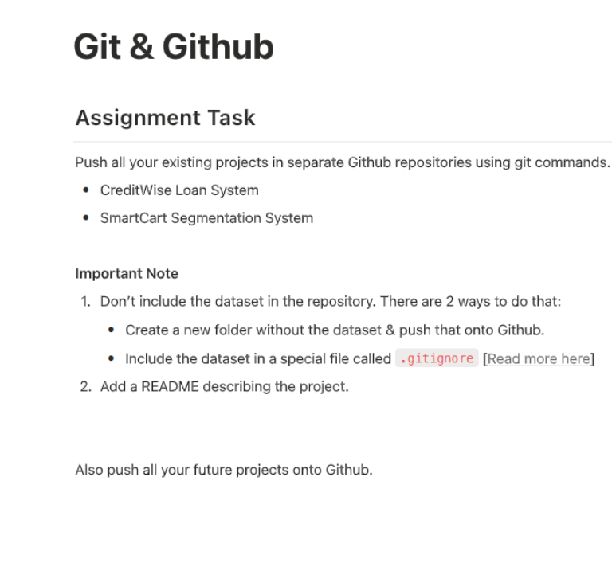

# Submodule 35.21: Git & GitHub Assignment Task (Hinglish)

## 1. Assignment Task ki Details

Lecture video assignment task (`assignment_task.png`):

```text
Git & GitHub
Assignment Task:
Apne puraane sabhi projects ko alag-alag GitHub repositories mein git commands ke through push karein:
• CreditWise Loan System
• SmartCart Segmentation System

Important Note:
1. Dataset ko repository ke andar include NA karein. Iske 2 tareeqe hain:
   • Bina dataset ke naya folder banakar push karein.
   • Dataset ko ek special file `.gitignore` mein add karein.
2. Har project ke liye ek accha README.md add karein jo project describe kare.

Aage ke sabhi future projects bhi isi tarah GitHub par push karein.
```

---

## 2. Visual Reference



---

## 3. `.gitignore` File Samajhna

Data Science aur ML mein bade datasets (jaise 100MB+ `.csv` files) aur virtual environments ko kabhi bhi GitHub par push nahi karna chahiye. GitHub 100MB se badi file par error de deta hai.

### Standard Data Science `.gitignore` File:
Project folder ke andar `.gitignore` naam ki file banayein aur yeh likhein:

```text
# Python cache files
__pycache__/
*.pyc

# Virtual Environment
venv/
env/

# Datasets (ZAROORI)
*.csv
*.xlsx
*.zip
data/

# Model Files
*.pkl
*.pt
*.h5

# Passwords
.env
```

---

## 4. Project 1: CreditWise Loan System ko Push Karna

### Step 1: Project Folder mein Jayein
```bash
cd CreditWise_Loan_System
```

### Step 2: Git shuru karein aur `.gitignore` banayein
```bash
git init
echo "*.csv" >> .gitignore
echo "__pycache__/" >> .gitignore
```

### Step 3: Project `README.md` Likhein
```markdown
# CreditWise Loan System

## Project Overview
Yeh project loan applicants ka risk predict karne ke liye Supervised Machine Learning classification models (Logistic Regression, Random Forest) use karta hai.

## Features
- Imbalanced data handling (SMOTE)
- Data Preprocessing aur Feature Scaling
- Evaluation: ROC-AUC, F1-Score aur Confusion Matrix
```

### Step 4: Add, Commit aur Push
```bash
git add .
git commit -m "Add CreditWise Loan System code and documentation"
git branch -M main
git remote add origin https://github.com/aapka-username/creditwise-loan-system.git
git push -u origin main
```

---

## 5. Project 2: SmartCart Segmentation System ko Push Karna

```bash
cd SmartCart_Segmentation_System
git init
echo "*.csv" >> .gitignore
git add .
git commit -m "Add SmartCart customer segmentation clustering pipeline"
git branch -M main
git remote add origin https://github.com/aapka-username/smartcart-segmentation-system.git
git push -u origin main
```

Dono projects alag-alag repositories mein clean aur professionally GitHub par live ho jayenge!

---

## 6. Visual Reference


