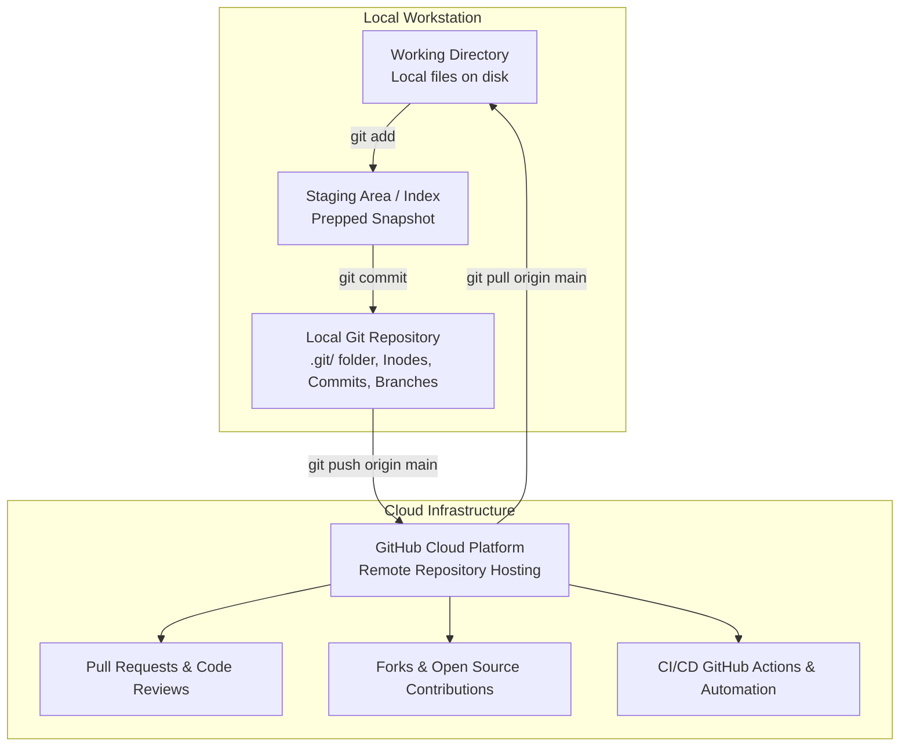

# Lecture 35: Git & GitHub Engineering Curriculum

Welcome to the definitive master curriculum repository for **Lecture 35: Git & GitHub Foundations**. Version control is the foundational operating system of modern software engineering, distributed machine learning pipelines, and collaborative AI development.

From training deep learning models across remote GPU clusters to contributing to global open-source frameworks like PyTorch and Scikit-Learn, Git and GitHub are mandatory skills for every engineer. This course builds deep muscle memory across CLI commands, branching architectures, merge conflict resolution, and defensive project governance.

---

## Architecture: Git vs GitHub vs Operating System

---

## Comprehensive Submodule Roadmap

This curriculum is organized into 21 dedicated topic submodules alongside an industrial practice suite. Every submodule contains dual-language documentation (English `README.md` and Hinglish `README_HINGLISH.md`) alongside Mermaid diagrams and compiled PDFs:

| Submodule | Topic Title | Core Concepts & Commands Covered | Visual / Diagram Ref | Documentation Links |
| :--- | :--- | :--- | :--- | :--- |
| **35.01** | **What is Git & GitHub?** | Version control necessity, Git vs GitHub architecture | Diagram / Concepts | [English](file:///c:/Users/Shivam%20Keshari/OneDrive/Desktop/AI-ML/lecture_35/Notes_35.01/README.md) \| [Hinglish](file:///c:/Users/Shivam%20Keshari/OneDrive/Desktop/AI-ML/lecture_35/Notes_35.01/README_HINGLISH.md) |
| **35.02** | **Creating a GitHub Account** | Sign up, professional usernames, student developer pack | Diagram / Concepts | [English](file:///c:/Users/Shivam%20Keshari/OneDrive/Desktop/AI-ML/lecture_35/Notes_35.02/README.md) \| [Hinglish](file:///c:/Users/Shivam%20Keshari/OneDrive/Desktop/AI-ML/lecture_35/Notes_35.02/README_HINGLISH.md) |
| **35.03** | **Using GitHub** | Web UI, repository creation, Public vs Private, commits | Diagram / Concepts | [English](file:///c:/Users/Shivam%20Keshari/OneDrive/Desktop/AI-ML/lecture_35/Notes_35.03/README.md) \| [Hinglish](file:///c:/Users/Shivam%20Keshari/OneDrive/Desktop/AI-ML/lecture_35/Notes_35.03/README_HINGLISH.md) |
| **35.04** | **Using Git** | CLI vs GUI clients, speed, remote cloud servers | Diagram / Concepts | [English](file:///c:/Users/Shivam%20Keshari/OneDrive/Desktop/AI-ML/lecture_35/Notes_35.04/README.md) \| [Hinglish](file:///c:/Users/Shivam%20Keshari/OneDrive/Desktop/AI-ML/lecture_35/Notes_35.04/README_HINGLISH.md) |
| **35.05** | **Configuring Git** | `git config --global user.name`, `user.email`, list | Diagram / Concepts | [English](file:///c:/Users/Shivam%20Keshari/OneDrive/Desktop/AI-ML/lecture_35/Notes_35.05/README.md) \| [Hinglish](file:///c:/Users/Shivam%20Keshari/OneDrive/Desktop/AI-ML/lecture_35/Notes_35.05/README_HINGLISH.md) |
| **35.06** | **Git with VSCode** | Integrated terminal, Git Bash profile setup | Diagram / Concepts | [English](file:///c:/Users/Shivam%20Keshari/OneDrive/Desktop/AI-ML/lecture_35/Notes_35.06/README.md) \| [Hinglish](file:///c:/Users/Shivam%20Keshari/OneDrive/Desktop/AI-ML/lecture_35/Notes_35.06/README_HINGLISH.md) |
| **35.07** | **Clone Command** | `git clone <url>`, `.git` directory, remote tracking | Diagram / Concepts | [English](file:///c:/Users/Shivam%20Keshari/OneDrive/Desktop/AI-ML/lecture_35/Notes_35.07/README.md) \| [Hinglish](file:///c:/Users/Shivam%20Keshari/OneDrive/Desktop/AI-ML/lecture_35/Notes_35.07/README_HINGLISH.md) |
| **35.08** | **Status Command** | 3 States (Working Dir, Staging, Repo), postal analogy | Diagram / Concepts | [English](file:///c:/Users/Shivam%20Keshari/OneDrive/Desktop/AI-ML/lecture_35/Notes_35.08/README.md) \| [Hinglish](file:///c:/Users/Shivam%20Keshari/OneDrive/Desktop/AI-ML/lecture_35/Notes_35.08/README_HINGLISH.md) |
| **35.09** | **Add & Commit Commands** | 2-step commit, `git add .`, `git commit -m`, SHA-1 | Diagram / Concepts | [English](file:///c:/Users/Shivam%20Keshari/OneDrive/Desktop/AI-ML/lecture_35/Notes_35.09/README.md) \| [Hinglish](file:///c:/Users/Shivam%20Keshari/OneDrive/Desktop/AI-ML/lecture_35/Notes_35.09/README_HINGLISH.md) |
| **35.10** | **Push Command** | `git push origin main`, upstream `-u` tracking | Diagram / Concepts | [English](file:///c:/Users/Shivam%20Keshari/OneDrive/Desktop/AI-ML/lecture_35/Notes_35.10/README.md) \| [Hinglish](file:///c:/Users/Shivam%20Keshari/OneDrive/Desktop/AI-ML/lecture_35/Notes_35.10/README_HINGLISH.md) |
| **35.11** | **Init Command** | `git init`, `.git` internal architecture | Diagram / Concepts | [English](file:///c:/Users/Shivam%20Keshari/OneDrive/Desktop/AI-ML/lecture_35/Notes_35.11/README.md) \| [Hinglish](file:///c:/Users/Shivam%20Keshari/OneDrive/Desktop/AI-ML/lecture_35/Notes_35.11/README_HINGLISH.md) |
| **35.12** | **Pushing Local Repo** | `git remote add origin`, `git branch -M main`, push | Diagram / Concepts | [English](file:///c:/Users/Shivam%20Keshari/OneDrive/Desktop/AI-ML/lecture_35/Notes_35.12/README.md) \| [Hinglish](file:///c:/Users/Shivam%20Keshari/OneDrive/Desktop/AI-ML/lecture_35/Notes_35.12/README_HINGLISH.md) |
| **35.13** | **Git Workflow** | Daily development cycle, best practices | Diagram / Concepts | [English](file:///c:/Users/Shivam%20Keshari/OneDrive/Desktop/AI-ML/lecture_35/Notes_35.13/README.md) \| [Hinglish](file:///c:/Users/Shivam%20Keshari/OneDrive/Desktop/AI-ML/lecture_35/Notes_35.13/README_HINGLISH.md) |
| **35.14** | **Git Branches** | Branching theory, isolation, parallel feature workflows | Diagram / Concepts | [English](file:///c:/Users/Shivam%20Keshari/OneDrive/Desktop/AI-ML/lecture_35/Notes_35.14/README.md) \| [Hinglish](file:///c:/Users/Shivam%20Keshari/OneDrive/Desktop/AI-ML/lecture_35/Notes_35.14/README_HINGLISH.md) |
| **35.15** | **Branch Commands** | `git branch`, `git checkout -b`, `git switch`, delete | Diagram / Concepts | [English](file:///c:/Users/Shivam%20Keshari/OneDrive/Desktop/AI-ML/lecture_35/Notes_35.15/README.md) \| [Hinglish](file:///c:/Users/Shivam%20Keshari/OneDrive/Desktop/AI-ML/lecture_35/Notes_35.15/README_HINGLISH.md) |
| **35.16** | **Merging Branches** | Local merge, GitHub Pull Requests (PRs), code review | Diagram / Concepts | [English](file:///c:/Users/Shivam%20Keshari/OneDrive/Desktop/AI-ML/lecture_35/Notes_35.16/README.md) \| [Hinglish](file:///c:/Users/Shivam%20Keshari/OneDrive/Desktop/AI-ML/lecture_35/Notes_35.16/README_HINGLISH.md) |
| **35.17** | **Pull Command** | `git pull origin main`, fetch vs pull distinction | Diagram / Concepts | [English](file:///c:/Users/Shivam%20Keshari/OneDrive/Desktop/AI-ML/lecture_35/Notes_35.17/README.md) \| [Hinglish](file:///c:/Users/Shivam%20Keshari/OneDrive/Desktop/AI-ML/lecture_35/Notes_35.17/README_HINGLISH.md) |
| **35.18** | **Merge Conflicts** | Conflict markers, manual resolution, completing merge | Diagram / Concepts | [English](file:///c:/Users/Shivam%20Keshari/OneDrive/Desktop/AI-ML/lecture_35/Notes_35.18/README.md) \| [Hinglish](file:///c:/Users/Shivam%20Keshari/OneDrive/Desktop/AI-ML/lecture_35/Notes_35.18/README_HINGLISH.md) |
| **35.19** | **Fixing Mistakes** | Unstaging (`restore`), amend, reset vs revert | Diagram / Concepts | [English](file:///c:/Users/Shivam%20Keshari/OneDrive/Desktop/AI-ML/lecture_35/Notes_35.19/README.md) \| [Hinglish](file:///c:/Users/Shivam%20Keshari/OneDrive/Desktop/AI-ML/lecture_35/Notes_35.19/README_HINGLISH.md) |
| **35.20** | **What is Forking?** | Forking vs cloning, open-source PR contribution model | Diagram / Concepts | [English](file:///c:/Users/Shivam%20Keshari/OneDrive/Desktop/AI-ML/lecture_35/Notes_35.20/README.md) \| [Hinglish](file:///c:/Users/Shivam%20Keshari/OneDrive/Desktop/AI-ML/lecture_35/Notes_35.20/README_HINGLISH.md) |
| **35.21** | **Assignment Task** | Pushing CreditWise & SmartCart with `.gitignore` & README | `assignment_task.png` | [English](file:///c:/Users/Shivam%20Keshari/OneDrive/Desktop/AI-ML/lecture_35/Notes_35.21/README.md) \| [Hinglish](file:///c:/Users/Shivam%20Keshari/OneDrive/Desktop/AI-ML/lecture_35/Notes_35.21/README_HINGLISH.md) |
| **Practice**| **Industrial Scenarios** | Production hotfix, merge conflict resolution, secret leak | Multiple | [English Questions](file:///c:/Users/Shivam%20Keshari/OneDrive/Desktop/AI-ML/lecture_35/Practice_Problems/README.md) \| [Hinglish Questions](file:///c:/Users/Shivam%20Keshari/OneDrive/Desktop/AI-ML/lecture_35/Practice_Problems/README_HINGLISH.md) \| [Solutions](file:///c:/Users/Shivam%20Keshari/OneDrive/Desktop/AI-ML/lecture_35/Practice_Problems/Solutions.md) |

---

## Core Command Quick Reference

| Command | Primary Function | Safe Usage Tip |
| :--- | :--- | :--- |
| **`git init`** | Initializes a new local Git repository | Run once at project root |
| **`git clone <url>`** | Clones a remote repository to local machine | Automatically sets up `origin` remote |
| **`git status`** | Displays working tree and staging state | Run before adding and committing |
| **`git add <file>` / `.`** | Stages modifications for next commit | Use `.gitignore` to avoid staging secrets or data |
| **`git commit -m "..."`** | Records an immutable project snapshot | Write concise, imperative commit messages |
| **`git push origin main`** | Uploads local commits to GitHub cloud | Use `-u` on first push to configure upstream |
| **`git pull origin main`** | Downloads and merges remote commits | Run daily before starting new work |
| **`git checkout -b <name>`** | Creates and switches to a new branch | Keeps `main` branch clean and production-ready |
| **`git merge <branch>`** | Combines branch history into current branch | Always test before merging into `main` |
| **`git restore --staged <f>`**| Unstages a file without losing disk edits | Safe replacement for `git reset HEAD` |
| **`git revert <commit>`** | Safely inverts an old commit via a new commit | Recommended method for shared public branches |
