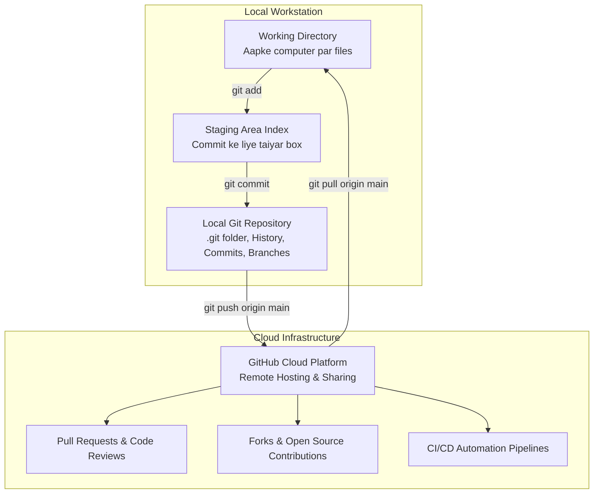

# Lecture 35: Git & GitHub Engineering Curriculum (Hinglish)

Swagat hai **Lecture 35: Git & GitHub Foundations** ke master curriculum repository mein! Version control modern software development, distributed machine learning systems, aur AI engineering ka sabse fundamental tool hai.

Chahe kisi remote high-end cloud GPU server par model train karna ho ya PyTorch aur Scikit-Learn jaise global open-source projects mein contribute karna ho, Git aur GitHub har engineer ke liye aana anivarya hai. Is module mein humne CLI commands, branching models, merge conflict resolution, pull requests, aur defensive project governance ko completely master kiya hai.

---

## Architecture: Git vs GitHub vs Operating System

---

## Comprehensive Submodule Roadmap

Is lecture ko 21 dedicated topic submodules aur 1 comprehensive industrial practice suite mein divide kiya gaya hai. Har module mein complete English aur Hinglish documentation, Mermaid diagrams, aur compiled PDFs shamil hain:

| Submodule | Topic Title | Key Concepts & Commands | Visual / Diagram Ref | Documentation Links |
| :--- | :--- | :--- | :--- | :--- |
| **35.01** | **What is Git & GitHub?** | Version control zaroorat, Git vs GitHub difference | Diagram / Concepts | [English](file:///c:/Users/Shivam%20Keshari/OneDrive/Desktop/AI-ML/lecture_35/Notes_35.01/README.md) \| [Hinglish](file:///c:/Users/Shivam%20Keshari/OneDrive/Desktop/AI-ML/lecture_35/Notes_35.01/README_HINGLISH.md) |
| **35.02** | **Creating a GitHub Account** | Sign up, professional usernames, student developer pack | Diagram / Concepts | [English](file:///c:/Users/Shivam%20Keshari/OneDrive/Desktop/AI-ML/lecture_35/Notes_35.02/README.md) \| [Hinglish](file:///c:/Users/Shivam%20Keshari/OneDrive/Desktop/AI-ML/lecture_35/Notes_35.02/README_HINGLISH.md) |
| **35.03** | **Using GitHub** | Web UI, repository creation, Public vs Private, commits | Diagram / Concepts | [English](file:///c:/Users/Shivam%20Keshari/OneDrive/Desktop/AI-ML/lecture_35/Notes_35.03/README.md) \| [Hinglish](file:///c:/Users/Shivam%20Keshari/OneDrive/Desktop/AI-ML/lecture_35/Notes_35.03/README_HINGLISH.md) |
| **35.04** | **Using Git** | CLI vs GUI clients, speed, remote cloud servers | Diagram / Concepts | [English](file:///c:/Users/Shivam%20Keshari/OneDrive/Desktop/AI-ML/lecture_35/Notes_35.04/README.md) \| [Hinglish](file:///c:/Users/Shivam%20Keshari/OneDrive/Desktop/AI-ML/lecture_35/Notes_35.04/README_HINGLISH.md) |
| **35.05** | **Configuring Git** | `git config --global user.name`, `user.email`, list | Diagram / Concepts | [English](file:///c:/Users/Shivam%20Keshari/OneDrive/Desktop/AI-ML/lecture_35/Notes_35.05/README.md) \| [Hinglish](file:///c:/Users/Shivam%20Keshari/OneDrive/Desktop/AI-ML/lecture_35/Notes_35.05/README_HINGLISH.md) |
| **35.06** | **Git with VSCode** | Integrated terminal, Git Bash profile setup | Diagram / Concepts | [English](file:///c:/Users/Shivam%20Keshari/OneDrive/Desktop/AI-ML/lecture_35/Notes_35.06/README.md) \| [Hinglish](file:///c:/Users/Shivam%20Keshari/OneDrive/Desktop/AI-ML/lecture_35/Notes_35.06/README_HINGLISH.md) |
| **35.07** | **Clone Command** | `git clone <url>`, `.git` directory, remote tracking | Diagram / Concepts | [English](file:///c:/Users/Shivam%20Keshari/OneDrive/Desktop/AI-ML/lecture_35/Notes_35.07/README.md) \| [Hinglish](file:///c:/Users/Shivam%20Keshari/OneDrive/Desktop/AI-ML/lecture_35/Notes_35.07/README_HINGLISH.md) |
| **35.08** | **Status Command** | 3 States (Working Dir, Staging, Repo), postal analogy | Diagram / Concepts | [English](file:///c:/Users/Shivam%20Keshari/OneDrive/Desktop/AI-ML/lecture_35/Notes_35.08/README.md) \| [Hinglish](file:///c:/Users/Shivam%20Keshari/OneDrive/Desktop/AI-ML/lecture_35/Notes_35.08/README_HINGLISH.md) |
| **35.09** | **Add & Commit Commands** | 2-step commit, `git add .`, `git commit -m`, SHA-1 | Diagram / Concepts | [English](file:///c:/Users/Shivam%20Keshari/OneDrive/Desktop/AI-ML/lecture_35/Notes_35.09/README.md) \| [Hinglish](file:///c:/Users/Shivam%20Keshari/OneDrive/Desktop/AI-ML/lecture_35/Notes_35.09/README_HINGLISH.md) |
| **35.10** | **Push Command** | `git push origin main`, upstream `-u` tracking | Diagram / Concepts | [English](file:///c:/Users/Shivam%20Keshari/OneDrive/Desktop/AI-ML/lecture_35/Notes_35.10/README.md) \| [Hinglish](file:///c:/Users/Shivam%20Keshari/OneDrive/Desktop/AI-ML/lecture_35/Notes_35.10/README_HINGLISH.md) |
| **35.11** | **Init Command** | `git init`, `.git` internal architecture | Diagram / Concepts | [English](file:///c:/Users/Shivam%20Keshari/OneDrive/Desktop/AI-ML/lecture_35/Notes_35.11/README.md) \| [Hinglish](file:///c:/Users/Shivam%20Keshari/OneDrive/Desktop/AI-ML/lecture_35/Notes_35.11/README_HINGLISH.md) |
| **35.12** | **Pushing Local Repo** | `git remote add origin`, `git branch -M main`, push | Diagram / Concepts | [English](file:///c:/Users/Shivam%20Keshari/OneDrive/Desktop/AI-ML/lecture_35/Notes_35.12/README.md) \| [Hinglish](file:///c:/Users/Shivam%20Keshari/OneDrive/Desktop/AI-ML/lecture_35/Notes_35.12/README_HINGLISH.md) |
| **35.13** | **Git Workflow** | Daily development cycle, best practices | Diagram / Concepts | [English](file:///c:/Users/Shivam%20Keshari/OneDrive/Desktop/AI-ML/lecture_35/Notes_35.13/README.md) \| [Hinglish](file:///c:/Users/Shivam%20Keshari/OneDrive/Desktop/AI-ML/lecture_35/Notes_35.13/README_HINGLISH.md) |
| **35.14** | **Git Branches** | Branching theory, isolation, parallel feature workflows | Diagram / Concepts | [English](file:///c:/Users/Shivam%20Keshari/OneDrive/Desktop/AI-ML/lecture_35/Notes_35.14/README.md) \| [Hinglish](file:///c:/Users/Shivam%20Keshari/OneDrive/Desktop/AI-ML/lecture_35/Notes_35.14/README_HINGLISH.md) |
| **35.15** | **Branch Commands** | `git branch`, `git checkout -b`, `git switch`, delete | Diagram / Concepts | [English](file:///c:/Users/Shivam%20Keshari/OneDrive/Desktop/AI-ML/lecture_35/Notes_35.15/README.md) \| [Hinglish](file:///c:/Users/Shivam%20Keshari/OneDrive/Desktop/AI-ML/lecture_35/Notes_35.15/README_HINGLISH.md) |
| **35.16** | **Merging Branches** | Local merge, GitHub Pull Requests (PRs), code review | Diagram / Concepts | [English](file:///c:/Users/Shivam%20Keshari/OneDrive/Desktop/AI-ML/lecture_35/Notes_35.16/README.md) \| [Hinglish](file:///c:/Users/Shivam%20Keshari/OneDrive/Desktop/AI-ML/lecture_35/Notes_35.16/README_HINGLISH.md) |
| **35.17** | **Pull Command** | `git pull origin main`, fetch vs pull distinction | Diagram / Concepts | [English](file:///c:/Users/Shivam%20Keshari/OneDrive/Desktop/AI-ML/lecture_35/Notes_35.17/README.md) \| [Hinglish](file:///c:/Users/Shivam%20Keshari/OneDrive/Desktop/AI-ML/lecture_35/Notes_35.17/README_HINGLISH.md) |
| **35.18** | **Merge Conflicts** | Conflict markers, manual resolution, completing merge | Diagram / Concepts | [English](file:///c:/Users/Shivam%20Keshari/OneDrive/Desktop/AI-ML/lecture_35/Notes_35.18/README.md) \| [Hinglish](file:///c:/Users/Shivam%20Keshari/OneDrive/Desktop/AI-ML/lecture_35/Notes_35.18/README_HINGLISH.md) |
| **35.19** | **Fixing Mistakes** | Unstaging (`restore`), amend, reset vs revert | Diagram / Concepts | [English](file:///c:/Users/Shivam%20Keshari/OneDrive/Desktop/AI-ML/lecture_35/Notes_35.19/README.md) \| [Hinglish](file:///c:/Users/Shivam%20Keshari/OneDrive/Desktop/AI-ML/lecture_35/Notes_35.19/README_HINGLISH.md) |
| **35.20** | **What is Forking?** | Forking vs cloning, open-source PR contribution model | Diagram / Concepts | [English](file:///c:/Users/Shivam%20Keshari/OneDrive/Desktop/AI-ML/lecture_35/Notes_35.20/README.md) \| [Hinglish](file:///c:/Users/Shivam%20Keshari/OneDrive/Desktop/AI-ML/lecture_35/Notes_35.20/README_HINGLISH.md) |
| **35.21** | **Assignment Task** | CreditWise aur SmartCart ko `.gitignore` & README ke sath push | `assignment_task.png` | [English](file:///c:/Users/Shivam%20Keshari/OneDrive/Desktop/AI-ML/lecture_35/Notes_35.21/README.md) \| [Hinglish](file:///c:/Users/Shivam%20Keshari/OneDrive/Desktop/AI-ML/lecture_35/Notes_35.21/README_HINGLISH.md) |
| **Practice**| **Industrial Scenarios** | Production hotfix, merge conflict resolution, secret leak | Multiple | [English Questions](file:///c:/Users/Shivam%20Keshari/OneDrive/Desktop/AI-ML/lecture_35/Practice_Problems/README.md) \| [Hinglish Questions](file:///c:/Users/Shivam%20Keshari/OneDrive/Desktop/AI-ML/lecture_35/Practice_Problems/README_HINGLISH.md) \| [Solutions](file:///c:/Users/Shivam%20Keshari/OneDrive/Desktop/AI-ML/lecture_35/Practice_Problems/Solutions.md) |

---

## Core Command Quick Reference

| Command | Mukhya Function | Safe Upyog Tip |
| :--- | :--- | :--- |
| **`git init`** | Naya local Git repository shuru karta hai | Project ke root folder par ek baar chalayein |
| **`git clone <url>`** | Remote repository ko computer par download karta hai | Automatically `origin` remote set kar deta hai |
| **`git status`** | Working tree aur staging area ki halat dikhata hai | Add aur commit karne se pehle hamesha chalayein |
| **`git add <file>` / `.`** | Files ko staging area mein daalta hai | Heavy datasets avoid karne ke liye `.gitignore` banayein |
| **`git commit -m "..."`** | Snapshot ko repository mein permanently save karta hai | Present tense mein clear aur meaningful message likhein |
| **`git push origin main`** | Local commits ko GitHub cloud par upload karta hai | Pehli baar `-u` flag use karein |
| **`git pull origin main`** | GitHub se naye commits download karke merge karta hai | Daily kaam shuru karne se pehle hamesha chalayein |
| **`git checkout -b <name>`** | Nayi branch banakar usme enter karta hai | Main branch ko safe aur clean rakhne ke liye zaroori |
| **`git merge <branch>`** | Branch ke code ko current branch mein jodta hai | Merge karne se pehle hamesha test karein |
| **`git restore --staged <f>`**| File ko unstage karta hai bina code delete kiye | Galti se add hui file ko hatane ke liye best |
| **`git revert <commit>`** | Purane commit ko naye commit se safely cancel karta hai | Shared public branches ke liye 100% safe |
