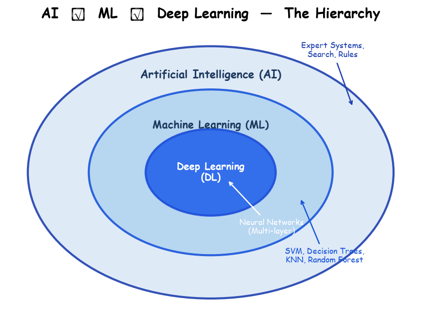
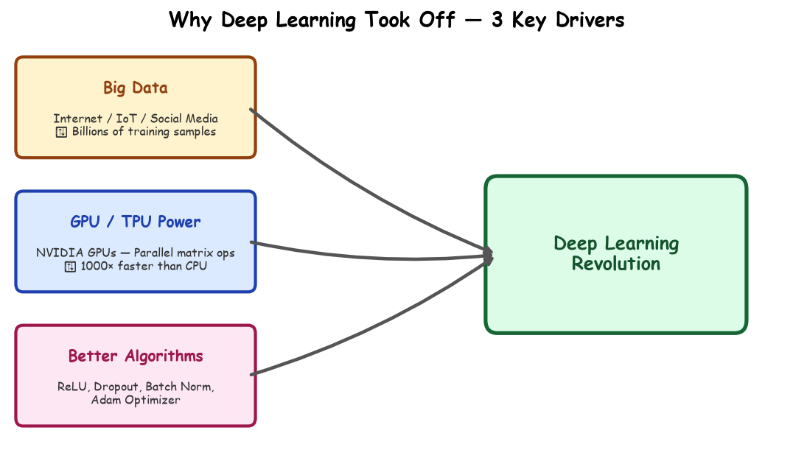

# Submodule 36.01: What is Deep Learning?

## 1. Defining Deep Learning

**Deep Learning (DL)** is a specialized subfield of **Machine Learning (ML)**, which itself is a branch of **Artificial Intelligence (AI)**. Deep Learning algorithms are inspired by the biological structure and cognitive functioning of the human brain, utilizing multi-layered artificial neural networks to learn representations directly from data.

---

## 2. Why Did Deep Learning Explode Recently?

Although the theoretical foundations of neural networks were established in the 1950s and 1980s, Deep Learning only achieved mainstream dominance over the past decade due to the confluence of three key technological breakthroughs:

1. **Explosion of Big Data**: Billions of interconnected smartphones, sensors, cameras, and internet services generate petabytes of unstructured text, audio, and visual data daily.
2. **GPU & TPU Acceleration**: Deep neural networks require trillions of floating-point matrix multiplications. Modern GPUs (Graphics Processing Units) and TPUs (Tensor Processing Units) perform thousands of parallel matrix computations simultaneously, reducing training times from months to hours.
3. **Algorithmic Breakthroughs**: Modern optimization techniques (e.g., Adam optimizer), robust non-linear activations (e.g., **ReLU**), effective regularization methods (e.g., Dropout, Batch Normalization), and novel architectures (CNNs, RNNs, Transformers) solved historical training bottlenecks like the vanishing gradient problem.

---

## 3. Real-World Applications of Deep Learning

Deep Learning powers the most transformative technological innovations of the 21st century:

| Domain | Application | Deep Learning Model Type |
| :--- | :--- | :--- |
| **Computer Vision (CV)** | Autonomous self-driving vehicles (Tesla, Waymo), medical imaging & cancer detection | Convolutional Neural Networks (CNNs), Vision Transformers (ViTs) |
| **Natural Language Processing (NLP)** | Large Language Models (ChatGPT, Claude, Gemini), automated real-time translation | Transformer Architectures, Attention Mechanisms |
| **Speech Recognition & Audio** | Voice assistants (Siri, Alexa), real-time speech-to-text transcription | Recurrent Neural Networks (RNNs), Conformer Models |
| **Recommendation Systems** | Personalized video & product feeds (YouTube, Netflix, Amazon) | Deep Collaborative Filtering, Two-Tower Embeddings |
| **Generative AI** | Text-to-image synthesis (Midjourney, DALL-E), AI code generation | Diffusion Models, Generative Adversarial Networks (GANs) |
