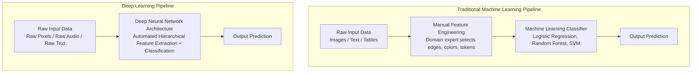
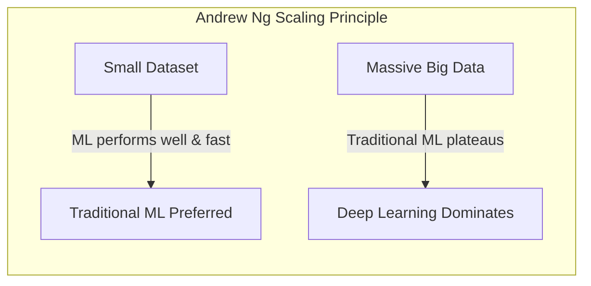
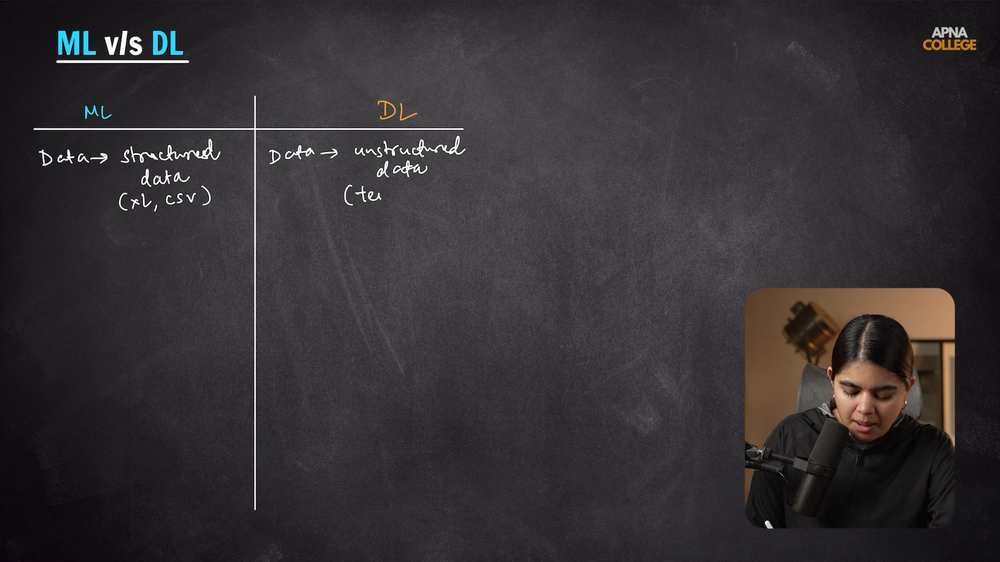

# Submodule 36.02: Machine Learning vs Deep Learning

## 1. Fundamental Conceptual Differences

While both Machine Learning and Deep Learning learn patterns from data, their architectural workflows, data dependencies, and feature extraction mechanisms are fundamentally distinct.

---

## 2. The Core Differentiator: Feature Engineering

- **Traditional Machine Learning**: Requires human engineers to manually craft numerical features (e.g., calculating pixel histograms, extracting SIFT/HOG descriptors for images, or computing TF-IDF vectors for text). If the engineered features are poor, the ML model performs poorly regardless of its complexity.
- **Deep Learning (End-to-End Representation Learning)**: Eliminates manual feature engineering. Early neural network layers automatically detect primitive low-level features (e.g., edges, gradients), intermediate layers compose them into mid-level shapes (e.g., textures, contours), and deeper layers assemble them into high-level semantic concepts (e.g., faces, wheels, objects).

---

## 3. Performance vs Amount of Data (Andrew Ng's Curve)

A defining characteristic distinguishing ML and DL is how model performance scales with dataset size:

- **Traditional ML Algorithms** (e.g., SVM, Random Forest, Logistic Regression): Performance improves initially with data, but quickly **plateaus**. Adding millions of additional records yields diminishing returns.
- **Deep Neural Networks**: Performance continues to scale almost linearly with increasing data volume and network capacity.

---

## 4. Detailed Dimension-by-Dimension Comparison

| Dimension | Traditional Machine Learning | Deep Learning |
| :--- | :--- | :--- |
| **Dataset Size Required** | Performs effectively on small to medium datasets (thousands of rows) | Requires massive datasets (millions of samples) to avoid severe overfitting |
| **Feature Extraction** | **Manual Feature Engineering** required by human domain experts | **Automated Feature Learning** performed hierarchically by hidden layers |
| **Hardware Dependency** | Runs efficiently on standard multi-core **CPUs** | Requires high-performance **GPUs / TPUs** with high VRAM bandwidth |
| **Training Duration** | Fast (seconds to minutes) | Prolonged (hours, days, or weeks depending on parameter count) |
| **Model Interpretability** | High (**Glass Box** models; feature importances, decision paths clear) | Low (**Black Box** models; millions of non-linear weights make reasoning opaque) |
| **Data Modality** | Best for structured, tabular data (Excel sheets, SQL tables) | Dominates unstructured data (high-resolution images, raw audio, video, text) |

---

## 5. Visual Reference

