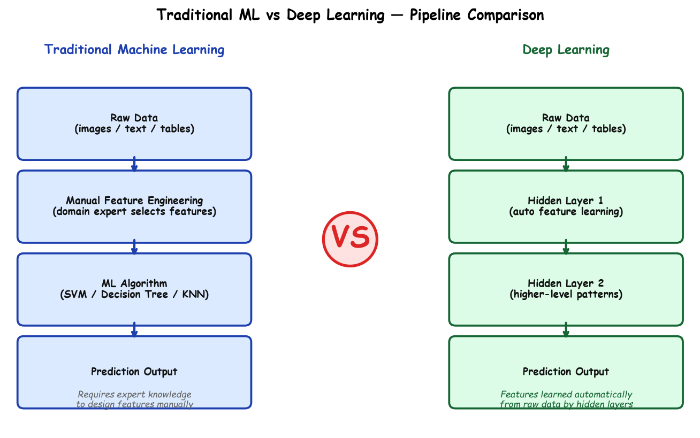

# Submodule 36.02: Machine Learning vs Deep Learning (Hinglish)

## 1. Mukhya Farak aur Pipeline

Traditional Machine Learning aur Deep Learning dono data se seekhte hain, lekin kaam karne ka tareeqa bilkul alag hota hai:

---

## 2. Sabse Bada Farak: Feature Engineering

- **Machine Learning**: Isme insaan (data scientist) ko manually features calculate karne padte hain (jaise image me se edges nikalna, color histograms banana, ya text ke liye word count banana). Agar feature nikalne me galti hui toh model fail ho jata hai.
- **Deep Learning**: Isme manual feature engineering ki bilkul zaroorat nahi hoti! Neural network ki pehli layers choti-choti lines aur edges detect karti hain, beech ki layers shapes detect karti hain, aur aakhri layers pure chehre (faces) ya objects detect kar leti hain. Ise **Automated Feature Learning** kehte hain.

---

## 3. Data ke Sath Performance (Andrew Ng ka Rule)

- **Machine Learning**: Agar data kam hai, toh ML algorithms bohot accha aur fast perform karte hain. Lekin jab data bohot zyada (Big Data) ho jata hai, toh ML ki performance ek limit par aakar ruk jati hai (**plateau** ho jati hai).
- **Deep Learning**: Chote data par DL overfit ho jata hai, lekin jaise-jaise data badhta hai, Deep Learning ki accuracy lagatar badhti chali jati hai.

---

## 4. Comparison Table

| Feature | Machine Learning | Deep Learning |
| :--- | :--- | :--- |
| **Kitna Data Chahiye?** | Kam se medium data par bohot accha chalta hai | Bohot bada data (Big Data / Millions of records) chahiye |
| **Feature Extraction** | **Manual**: Insaan ko khud features design karne padte hain | **Automatic**: Neural network khud data se features nikalta hai |
| **Hardware** | Normal computer ke **CPU** par aasani se chal jata hai | Heavy **NVIDIA GPU** ya TPU ke bina train nahi ho sakta |
| **Training Time** | Kuch seconds ya minutes | Ghanto, dino ya hafton ka samay lagta hai |
| **Interpretability** | **Glass Box**: Samajhna aasan hai ki model ne decision kyun liya | **Black Box**: Crodon parameters hone ki wajah se decision explain karna mushkil |
| **Data Type** | Tabular / Excel / CSV data ke liye best | Images, Video, Audio, aur Text ke liye unbeatable |
