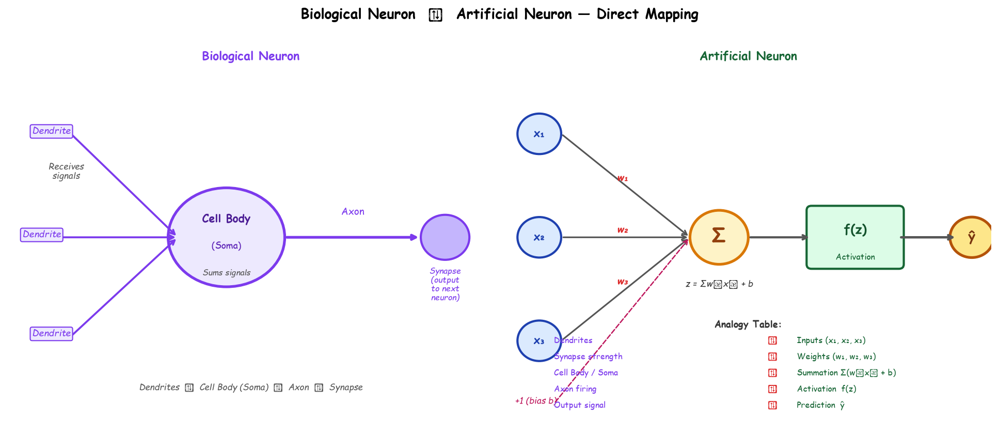
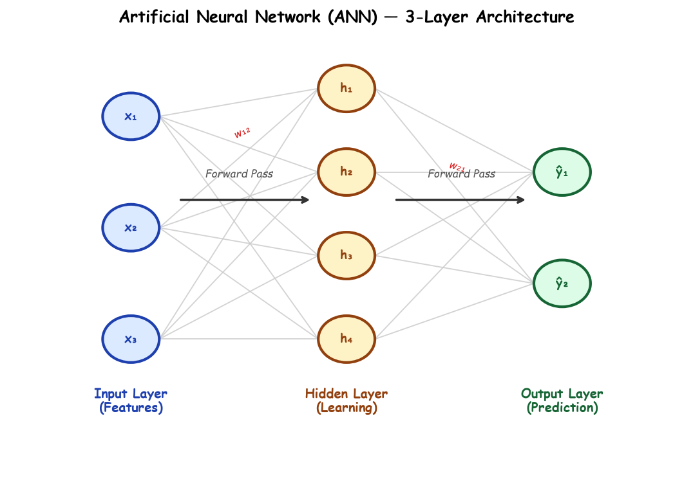

# Submodule 36.03: What are Neural Networks?

## 1. Biological Inspiration: The Human Brain

The foundational architecture of Deep Learning is inspired by the human neurological system. The human brain contains approximately **86 to 100 billion biological neurons**, each interconnected through thousands of synapses, forming a massively parallel information processing network.

### Biological vs Artificial Neuron Mapping:

| Biological Component | Artificial Neural Network Equivalent | Computational Role |
| :--- | :--- | :--- |
| **Dendrites** | **Input Features ($x_1, x_2, \dots, x_n$)** | Receives data inputs from preceding nodes |
| **Synaptic Weights** | **Weights ($w_1, w_2, \dots, w_n$)** | Controls the amplification/attenuation strength of each connection |
| **Cell Body (Soma)** | **Summation Node ($\sum w_i x_i + b$)** | Accumulates all weighted inputs plus bias offset |
| **Action Potential Threshold** | **Activation Function ($f(z)$)** | Decides whether and with what magnitude the neuron should fire |
| **Axon** | **Neuron Output ($\hat{y}$)** | Transmits computed activation signal to downstream layers |

---

## 2. Artificial Neural Network (ANN) Architecture

An **Artificial Neural Network (ANN)** is organized into discrete sequential groups of artificial neurons called **Layers**:

### The Three Fundamental Layer Types:
1. **Input Layer**:
   - The entry point of the network.
   - Contains exactly one node for every input feature (e.g., if predicting house prices using 3 features: `square_feet`, `bedrooms`, `age`, the input layer has 3 nodes).
   - Performs no mathematical transformations; simply passes values forward.
2. **Hidden Layer(s)**:
   - Intermediate layers situated between input and output layers.
   - Perform mathematical dot-products, bias addition, and non-linear activation functions.
   - Extract increasingly abstract feature representations.
   - Networks with multiple hidden layers are called **Deep Neural Networks**.
3. **Output Layer**:
   - The final layer responsible for producing the model's prediction.
   - Node count and activation depend on the problem type:
     - *Binary Classification*: 1 node with **Sigmoid** activation (probability $\in [0, 1]$).
     - *Multi-Class Classification*: $K$ nodes with **Softmax** activation (probability distribution summing to 1).
     - *Regression*: 1 node with **Linear** (no) activation (continuous real number).
