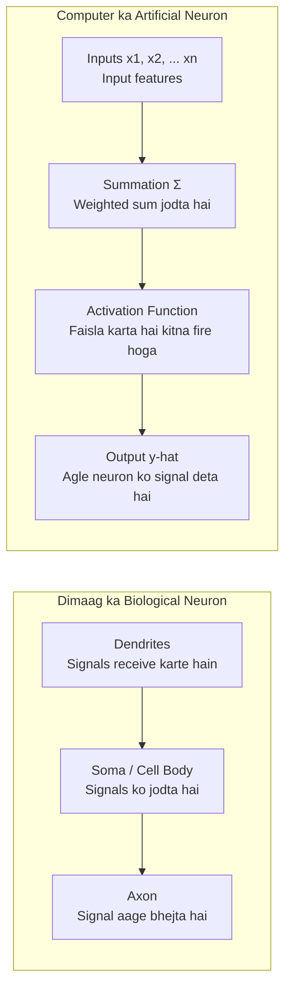
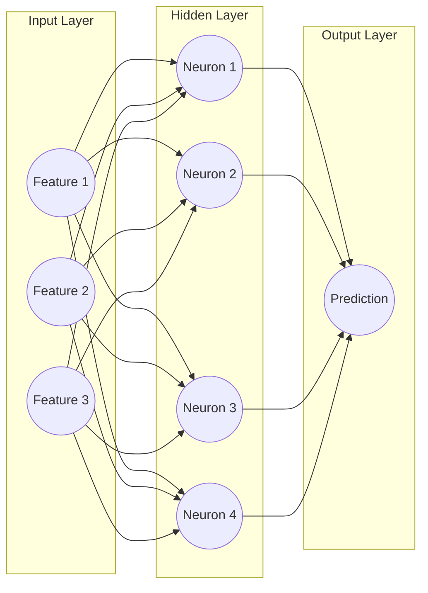

# Submodule 36.03: Neural Networks kya hote hain? (Hinglish)

## 1. Insani Dimaag se Inspiration

Deep Learning ki shuruaat insani dimaag (human brain) ki working samajh kar hui. Hamare dimaag mein lagbhag **86 se 100 billion biological neurons** hote hain jo aapas mein synapses ke zariye jude hote hain.

### Biological Neuron aur Artificial Neuron ka Comparison:

| Biological Dimaag | Artificial Neural Network | Kaam kya hai? |
| :--- | :--- | :--- |
| **Dendrites** | **Inputs ($x_1, x_2, \dots$)** | Bahar se information receive karna |
| **Synaptic Strength** | **Weights ($w_1, w_2, \dots$)** | Har input ki importance/strength tay karna |
| **Cell Body (Soma)** | **Summation ($\sum w_i x_i + b$)** | Sabhi signals ka total jod nikalna |
| **Firing Threshold** | **Activation Function** | Faisla lena ki signal aage bhejna hai ya nahi |
| **Axon** | **Output ($\hat{y}$)** | Final answer aage pass karna |

---

## 2. Neural Network ka Structure (Layers)

Ek Artificial Neural Network teen types ki **Layers** se milkar banta hai:

1. **Input Layer**:
   - Yeh network ka gateway hai jahan data enter karta hai.
   - Har feature ke liye ek node hota hai (jaise house prediction ke liye `size`, `rooms`, `location` $	o$ 3 input nodes).
2. **Hidden Layer(s)**:
   - Input aur Output ke beech ki layers ko Hidden Layers kehte hain.
   - Yeh layers data ke andar ke complex patterns aur non-linear relationships seekhti hain.
   - Jin networks mein 1 se zyada hidden layers hoti hain, unhe **Deep Neural Networks** kaha jata hai.
3. **Output Layer**:
   - Yeh final answer deti hai (jaise Spam hai ya nahi, ya phir car ki price kya hogi).
