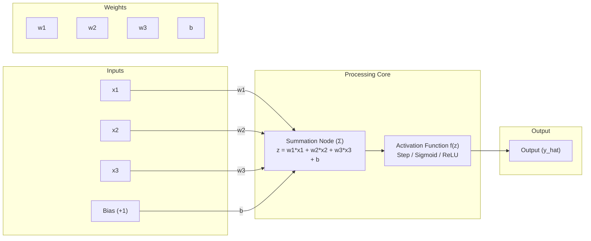
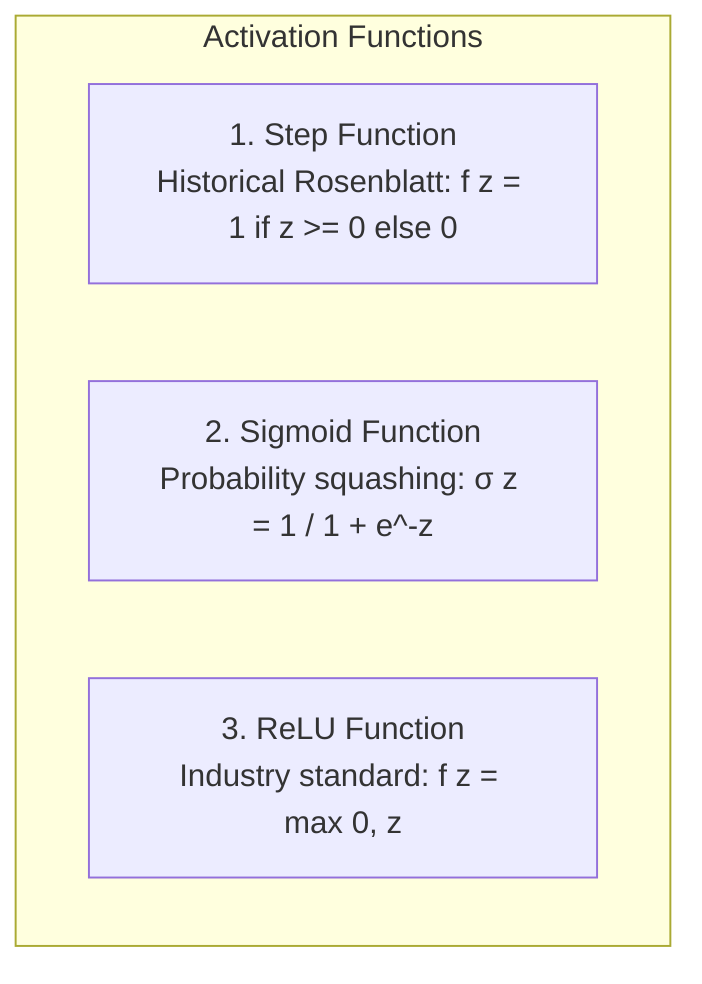
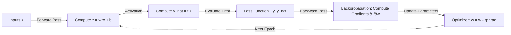

# Submodule 36.04: The Perceptron (In Depth)

## 1. Introduction & Historical Origins

The **Perceptron** is the simplest mathematical model of an artificial neuron and serves as the fundamental atomic building block of all modern deep learning architectures. It was invented in 1958 by **Frank Rosenblatt** at the Cornell Aeronautical Laboratory.

---

## 2. Mathematical Architecture of a Perceptron

A perceptron accepts multiple numerical input signals, computes a linear combination using synaptic weights and a bias term, and passes the result through an activation function to generate an output.

### The Step-by-Step Mathematical Formulation:

#### Step 1: Input Features Vector
$$\mathbf{x} = egin{bmatrix} x_1 \ x_2 \ dots \ x_n \end{bmatrix} \in \mathbb{R}^n$$

#### Step 2: Synaptic Weights Vector
$$\mathbf{w} = egin{bmatrix} w_1 \ w_2 \ dots \ w_n \end{bmatrix} \in \mathbb{R}^n$$
- Weights quantify the importance or contribution of each corresponding input feature to the final prediction.

#### Step 3: Bias Term ($b$)
- Bias is an independent constant scalar added to the weighted sum.
- **Why is Bias Essential?** Without a bias term ($b = 0$), the linear decision boundary is constrained to pass through the origin $(0, 0, \dots, 0)$. A non-zero bias shifts the activation threshold, allowing the model to fit data that does not pass through the origin.

#### Step 4: Net Input / Weighted Sum ($z$)
$$z = \sum_{i=1}^n w_i x_i + b = w_1 x_1 + w_2 x_2 + \dots + w_n x_n + b$$
In compact vector dot-product notation:
$$z = \mathbf{w}^T \mathbf{x} + b$$

#### Step 5: Activation Function & Final Output
$$\hat{y} = f(z) = f(\mathbf{w}^T \mathbf{x} + b)$$

---

## 3. Why are Activation Functions Mandatory?

If an artificial neuron only calculated $z = \mathbf{w}^T \mathbf{x} + b$, stacking multiple layers of neurons would be mathematically equivalent to a single linear equation:
$$	ext{Layer 2 Output} = \mathbf{W}_2 (\mathbf{W}_1 \mathbf{x} + \mathbf{b}_1) + \mathbf{b}_2 = (\mathbf{W}_2 \mathbf{W}_1)\mathbf{x} + (\mathbf{W}_2 \mathbf{b}_1 + \mathbf{b}_2) = \mathbf{W}' \mathbf{x} + \mathbf{b}'$$
No matter how many hidden layers are stacked, a purely linear network cannot solve non-linear problems. **Activation functions introduce non-linearity**, enabling neural networks to learn arbitrary, complex decision boundaries.

---

## 4. Key Activation Functions Introduced

### 1. Step Function (Threshold Logic Unit):
$$f(z) = egin{cases} 1 & 	ext{if } z \ge 0 \ 0 & 	ext{if } z < 0 \end{cases}$$
- *Limitation*: Non-differentiable at $z = 0$, with zero derivative everywhere else ($rac{df}{dz} = 0$). Cannot be trained via modern gradient descent.

### 2. Sigmoid Activation Function:
$$\sigma(z) = rac{1}{1 + e^{-z}}$$
- *Output Range*: $(0, 1)$
- *Properties*: Smooth, continuous, differentiable everywhere. Interpretable as a probability in binary classification.

### 3. ReLU (Rectified Linear Unit):
$$f(z) = \max(0, z)$$
- *Output Range*: $[0, \infty)$
- *Properties*: Computationally trivial ($O(1)$), does not saturate for positive inputs (mitigating vanishing gradients). Industry default for hidden layers.

---

## 5. The Complete Learning Cycle (Forward & Backward Pass)

1. **Forward Propagation**: Input data flows through weights, summation, and activation to compute prediction $\hat{y}$.
2. **Loss Calculation**: A loss function measures the discrepancy between predicted $\hat{y}$ and true ground-truth $y$.
3. **Backpropagation**: The chain rule of calculus propagates error gradients backward from output to input.
4. **Parameter Update (Optimizer)**: Optimization algorithms (like Stochastic Gradient Descent or Adam) update weights and biases to minimize loss:
$$w \leftarrow w - \eta rac{\partial L}{\partial w}$$
   where $\eta$ represents the learning rate.
