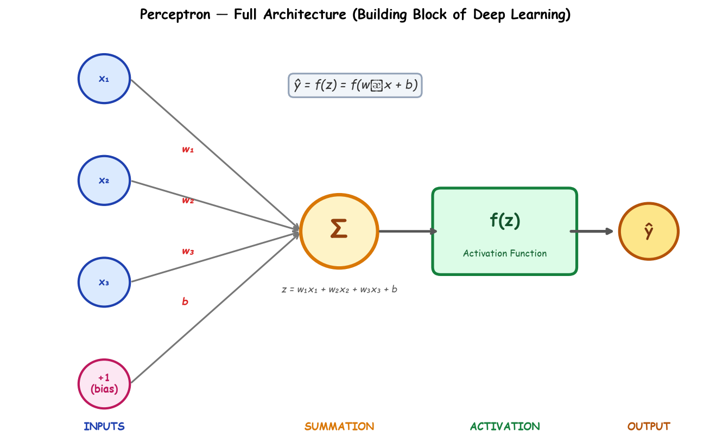
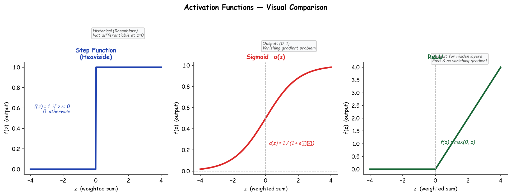
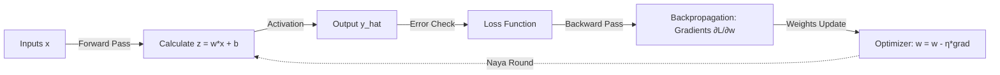

# Submodule 36.04: Perceptron (In Depth) (Hinglish)

## 1. Perceptron ka Parichay

**Perceptron** Deep Learning aur Neural Networks ki sabse basic unit (single artificial neuron) hai. Ise 1958 mein **Frank Rosenblatt** ne invent kiya tha. Pura deep learning isi ek neuron ke mathematical formula par khada hai.

---

## 2. Perceptron ka Mathematical Architecture

Perceptron inputs leta hai, unhe weights se multiply karta hai, bias jodta hai, aur activation function se pass karke output banata hai:

### Formula ka Breakdown:

1. **Inputs ($x_1, x_2, \dots$)**: Model ko milne wale raw features.
2. **Weights ($w_1, w_2, \dots$)**: Har feature ki importance ko darshate hain. Jis feature ka weight zyada hoga, output par uska asar utna zyada hoga.
3. **Bias ($b$)**: Yeh ek constant value hoti hai jo sum me judti hai.
   - **Bias kyun zaroori hai?** Agar bias na ho ($b = 0$), toh decision boundary hamesha origin $(0,0)$ se pass hogi. Bias boundary ko shift karne ki azaadi deta hai taaki agar saare inputs zero bhi hon, tab bhi neuron activate ho sake.
4. **Weighted Sum ($z$)**:
$$z = \sum_{i=1}^n w_i x_i + b = w_1 x_1 + w_2 x_2 + \dots + w_n x_n + b$$
Vector form mein:
$$z = \mathbf{w}^T \mathbf{x} + b$$
5. **Activation Function ($f(z)$)**:
$$\hat{y} = f(z)$$

---

## 3. Activation Function ki Zaroorat Kyun Hai?

Agar hum activation function na lagayein, toh chahe aap 100 layers jod lo, mathematically wo ek single straight line (linear equation) hi rahegi:
$$W_2(W_1 x + b_1) + b_2 = W' x + b'$$
Real-world problems linear nahi hotin. **Activation functions non-linearity introduce karte hain**, jisse model complex curves aur shapes seekh pata hai.

---

## 4. Teen Mukhya Activation Functions

1. **Step Function**:
$$f(z) = 1 	ext{ agar } z \ge 0, 	ext{ warna } 0$$
   *(Iska derivative zero hota hai, isliye modern gradient descent isme kaam nahi karta).*
2. **Sigmoid Function**:
$$\sigma(z) = rac{1}{1 + e^{-z}}$$
   *(Output hamesha $0$ aur $1$ ke beech hota hai, probability nikalne ke liye perfect).*
3. **ReLU (Rectified Linear Unit)**:
$$f(z) = \max(0, z)$$
   *(Negative values ko zero kar deta hai aur positive ko as-it-is chhod deta hai. Sabse fast aur popular).*

---

## 5. Neural Network Seekhta Kaise Hai? (Training Loop)

1. **Forward Pass**: Data inputs se start hokar formula ke zariye prediction $\hat{y}$ banata hai.
2. **Loss Function**: Check karta hai ki prediction sachai ($y$) se kitni door hai.
3. **Backpropagation**: Calculus ke chain rule se error ko peeche bhej kar gradients calculate karta hai.
4. **Optimizer**: Weights aur bias ko update karta hai taaki agle round me error kam ho:
$$w \leftarrow w - \eta rac{\partial L}{\partial w}$$
