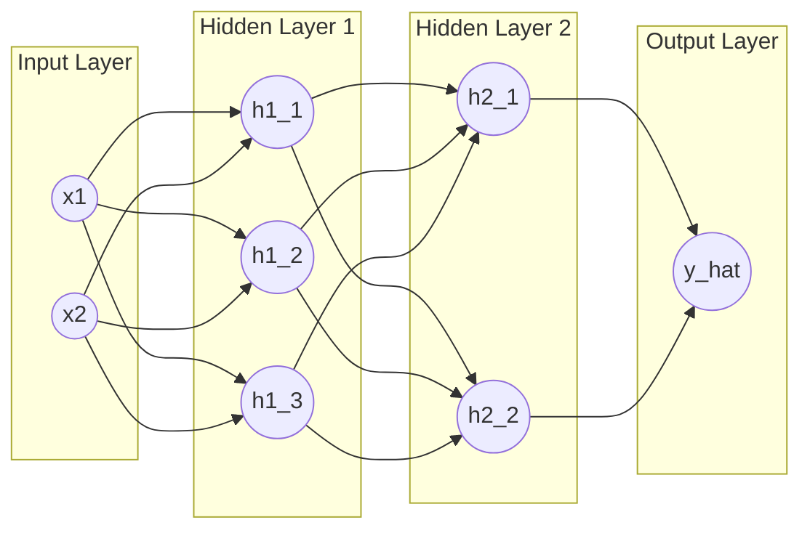
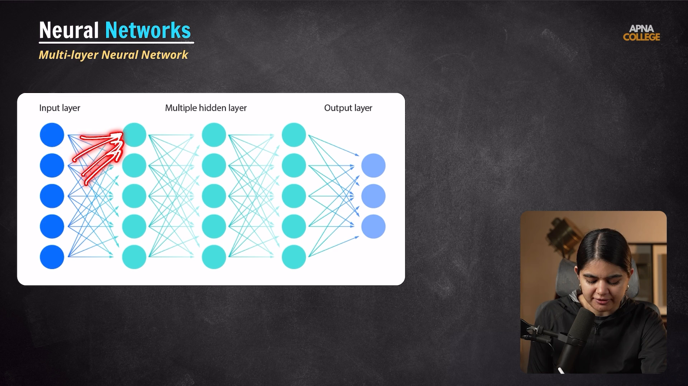

# Submodule 36.05: Multi-Layered Neural Networks (MLP)

## 1. The Limitation of a Single Perceptron

In 1969, **Marvin Minsky and Seymour Papert** published their landmark book *Perceptrons*, mathematically proving that a single-layer perceptron can **only solve linearly separable problems** (like AND, OR logic gates). It is mathematically incapable of solving non-linear decision boundaries like the **XOR (Exclusive OR) gate**.

This limitation caused the famous "AI Winter" until researchers developed **Multi-Layer Perceptrons (MLPs)**.

---

## 2. Multi-Layer Perceptron (MLP) Architecture

A **Multi-Layer Perceptron (MLP)** or Feedforward Deep Neural Network overcomes this limitation by inserting one or more **Hidden Layers** between the input and output layers.

### Architectural Terminology:
- **Fully Connected (Dense) Layer**: A layer where every single neuron connects to every single neuron in the subsequent layer.
- **Network Depth**: The total count of parameterized layers (Hidden layers + Output layer).
- **Network Width**: The number of neurons in a specific layer.
- **Universal Approximation Theorem**: A feedforward neural network with a single hidden layer containing a finite number of non-linear neurons can approximate any continuous mathematical function to arbitrary accuracy.

---

## 3. How Multi-Layer Networks Solve Non-Linearity

1. **Feature Space Warping**: Each hidden layer applies a linear transformation followed by a non-linear activation function, mathematically twisting and warping the feature space.
2. **Hierarchical Abstraction**:
   - Layer 1: Combines input features into linear boundaries.
   - Layer 2: Combines linear boundaries into convex polygonal regions.
   - Layer 3+: Assembles complex non-linear manifolds and curved boundaries, easily separating non-linear patterns like XOR.

---

## 4. Visual Reference

