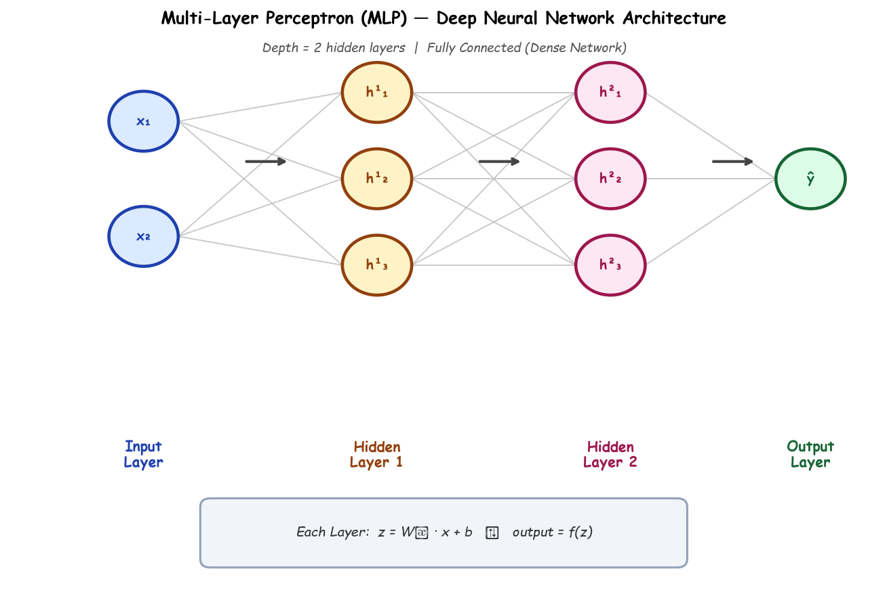

# Submodule 36.05: Multi-Layered Neural Networks (MLP) (Hinglish)

## 1. Single Perceptron ki Kamzori

1969 mein researchers ne prove kiya ki ek akela Perceptron sirf wahi problems solve kar sakta hai jo ek seedhi line se separate ho sakein (**linearly separable** jaise AND, OR gates). Lekin jab baat **XOR gate** ya real-world complex problems ki aati hai jahan seedhi line nahi khichi ja sakti, wahan single perceptron fail ho jata hai.

Is problem ko solve karne ke liye **Multi-Layer Perceptron (MLP)** ka invention hua.

---

## 2. Multi-Layer Neural Network ka Structure

Multi-layer network mein Input aur Output ke beech ek ya ek se zyada **Hidden Layers** laga di jati hain:

### Zaroori Terms:
- **Fully Connected (Dense) Layer**: Aisi layer jisme pichli layer ka har ek neuron agli layer ke har ek neuron se juda hota hai.
- **Depth**: Network mein kitni layers hain. Jitni zyada layers, utna "Deep" network.
- **Width**: Ek layer ke andar kitne neurons hain.
- **Universal Approximation Theorem**: Yeh theorem kehta hai ki agar neural network mein non-linear activation ho, toh wo duniya ke kisi bhi complex function ya curve ko approximate (learn) kar sakta hai.

---

## 3. Hidden Layers Complex Problems kaise solve karti hain?

Pehli layer data ki choti-choti lines banati hai, doosri layer un lines ko jodkar polygons aur curves banati hai, aur aakhri layer kisi bhi complex non-linear pattern (jaise XOR) ko aasani se solve kar leti hai.
