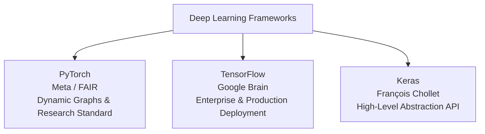
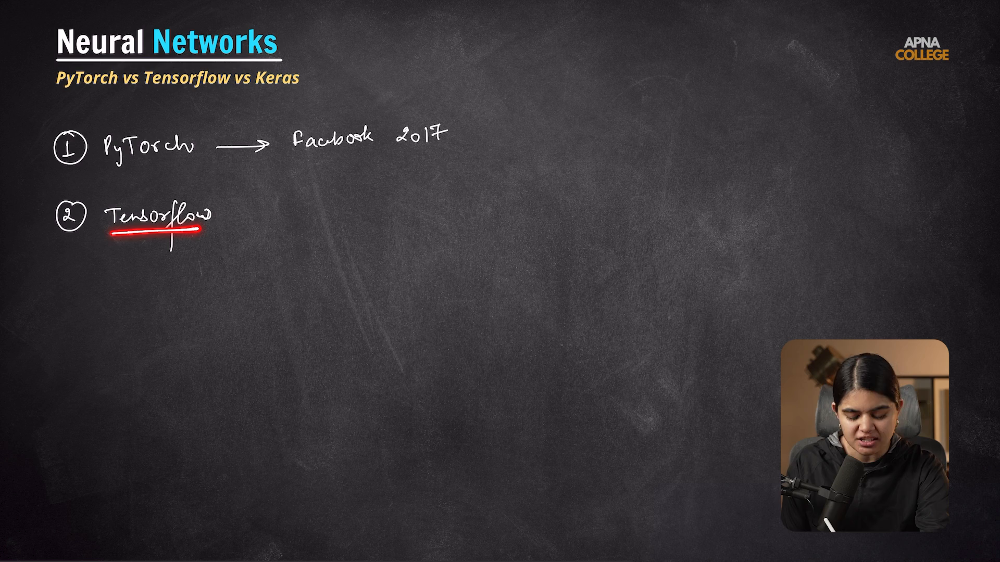

# Submodule 36.06: PyTorch vs TensorFlow vs Keras

## 1. The Deep Learning Framework Ecosystem

Building deep neural networks from scratch using raw Python and NumPy requires manually writing hundreds of lines of matrix derivatives and vector calculus. Deep learning frameworks automate **automatic differentiation (autograd)** and offload tensor computations to hardware accelerators (GPUs/TPUs).

---

## 2. Framework Comparison Matrix

| Feature | PyTorch | TensorFlow | Keras |
| :--- | :--- | :--- | :--- |
| **Origin / Maintainer** | Meta (Facebook AI Research) & Linux Foundation | Google Brain | François Chollet (integrated into TF / Multi-backend) |
| **Computation Graph** | **Dynamic** (Define-by-Run / Eager Execution) | Static (historically), Dynamic via TF 2.0 Eager Execution | High-level wrapper over backends |
| **Programming Style** | Highly **Pythonic**, object-oriented, intuitive debugging | Declarative, configuration-driven, robust serving | Minimalist, clean sequential & functional APIs |
| **Adoption Domain** | **Academic Research**, Hugging Face, Generative AI, LLMs | **Enterprise Production**, Mobile (TFLite), Embedded edge | Rapid prototyping, education, introductory deep learning |
| **Model Deployment** | TorchScript, ONNX, LibTorch (C++) | TF Serving, TFLite, TF.js, SavedModel | Exports via TensorFlow / ONNX pipelines |

---

## 3. Why PyTorch is Chosen for This Course

1. **Pythonic Mental Model**: PyTorch feels like native Python and NumPy. Writing a neural network in PyTorch involves subclassing `torch.nn.Module` and implementing standard Python loops.
2. **Interactive Debugging**: Because computation graphs are built dynamically on the fly, developers can inspect intermediate tensor activations using standard Python `print()` statements or IDE debuggers.
3. **Industry & Research Dominance**: Over 80% of recent AI research papers (NeurIPS, ICML, CVPR) and modern open-source models (Llama 3, Stable Diffusion) are authored natively in PyTorch.

---

## 4. Visual Reference

