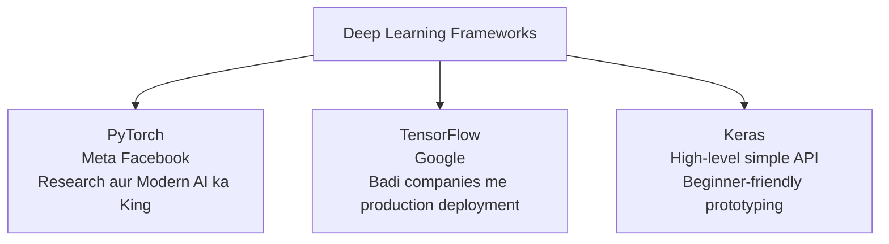

# Submodule 36.06: PyTorch vs TensorFlow vs Keras (Hinglish)

## 1. Deep Learning Frameworks ki Zaroorat

Agar hum raw Python ya NumPy se neural network banayein, toh calculus ke derivatives aur gradients manually likhne padenge jisme hazaron lines ka code lag jayega. Deep learning frameworks **Automatic Differentiation (Autograd)** provide karte hain aur calculations ko GPU par bohot tezi se chalate hain.

---

## 2. Comparison Matrix

| Feature | PyTorch | TensorFlow | Keras |
| :--- | :--- | :--- | :--- |
| **Company** | Meta (Facebook) | Google | Google (ab TF ke andar integrated) |
| **Graph Style** | **Dynamic**: Code line-by-line execute hota hai | Pehle static tha, ab TF 2.0 me eager execution hai | High-level abstraction |
| **Coding Style** | Bilkul aam **Python** jaisa lagta hai | Thoda complex aur enterprise focused | Bohot simple, 4-5 lines me model ban jata hai |
| **Kahan Use Hota Hai** | AI Research, ChatGPT, LLMs, Hugging Face | Badi companies ke production servers aur mobile apps me | Shuruaat seekhne aur rapid prototyping ke liye |
| **Debugging** | Bohot easy (normal `print` aur break points chalte hain) | Thoda mushkil | Aasan |

---

## 3. Hum PyTorch kyun padh rahe hain?

1. **Python jaisa natural**: PyTorch likhte waqt lagta hai ki hum normal Python code likh rahe hain.
2. **Debugging aasan hai**: Dynamic graph hone ki wajah se kisi bhi line par `print()` karke tensor check kar sakte hain.
3. **Industry aur Research Standard**: Aaj 80%+ nayi AI research aur open-source models (jaise Llama, Stable Diffusion) PyTorch me hi bante hain.
