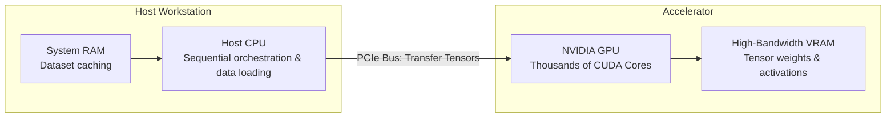

# Submodule 36.07: PyTorch Installation & Environment Setup

## 1. Hardware Architecture: CPU vs GPU Acceleration

Deep learning workloads consist predominantly of massive tensor dot-products and matrix additions.
- **CPU (Central Processing Unit)**: Optimized for sequential processing with a small number of fast, versatile cores (4 to 16 cores).
- **GPU (Graphics Processing Unit)**: Engineered with thousands of smaller, highly efficient **CUDA cores** designed to execute parallel SIMD (Single Instruction, Multiple Data) matrix arithmetic simultaneously.



---

## 2. PyTorch Installation Protocol

PyTorch is distributed via `pip` and `conda` through the official portal [pytorch.org/get-started/locally/](https://pytorch.org/get-started/locally/).

### 1. CPU-Only Installation (No NVIDIA GPU required):
```bash
pip install torch torchvision torchaudio
```

### 2. GPU-Accelerated Installation (NVIDIA CUDA 12.1+):
```bash
pip install torch torchvision torchaudio --index-url https://download.pytorch.org/whl/cu121
```

---

## 3. Hardware Verification Script

Execute the following Python snippet to verify PyTorch installation and inspect available compute hardware:

```python
import torch

print(f"PyTorch Version: {torch.__version__}")
cuda_available = torch.cuda.is_available()
print(f"CUDA (GPU) Available: {cuda_available}")

if cuda_available:
    device_count = torch.cuda.device_count()
    device_name = torch.cuda.get_device_name(0)
    print(f"Detected GPU Count: {device_count}")
    print(f"Active GPU Device: {device_name}")
else:
    print("Running in CPU-only computation mode.")
```

### Expected Output (GPU Machine):
```text
PyTorch Version: 2.3.0+cu121
CUDA (GPU) Available: True
Detected GPU Count: 1
Active GPU Device: NVIDIA GeForce RTX 4070
```

---

## 4. Visual Reference to Official Specification


