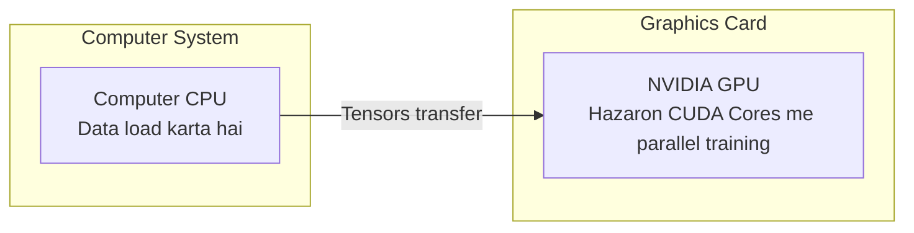

# Submodule 36.07: PyTorch Installation aur Hardware Setup (Hinglish)

## 1. Hardware: CPU vs GPU ka Farak

Deep Learning mein lakho-crodon matrix calculations hoti hain:
- **CPU**: Isme 4 se 16 powerful cores hote hain jo ek ke baad ek sequential kaam karte hain.
- **GPU (Graphics Card)**: Isme hazaron chote-chote **CUDA Cores** hote hain jo ek sath parallel matrix calculations kar sakte hain. Isliye neural networks GPU par 50x-100x fast train hote hain.



---

## 2. PyTorch Install Karne ka Tarika

Official portal: `https://pytorch.org/get-started/locally/`

### 1. Normal CPU Computer ke liye:
```bash
pip install torch torchvision torchaudio
```

### 2. NVIDIA GPU (CUDA) wale Computer ke liye:
```bash
pip install torch torchvision torchaudio --index-url https://download.pytorch.org/whl/cu121
```

---

## 3. Installation Check Script

Python mein check karein ki PyTorch install hua ya nahi aur GPU detect ho raha hai ya nahi:

```python
import torch

print(f"PyTorch Version: {torch.__version__}")
print(f"CUDA GPU Available: {torch.cuda.is_available()}")

if torch.cuda.is_available():
    print(f"GPU ka Naam: {torch.cuda.get_device_name(0)}")
```

---

## 4. Visual Reference


