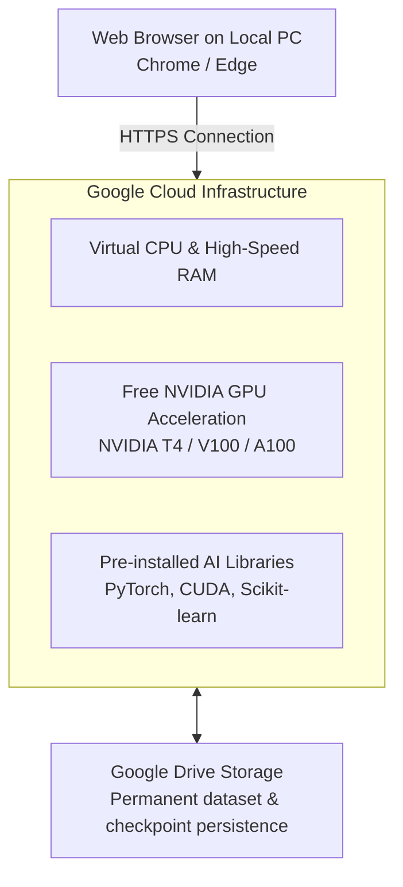

# Submodule 36.08: Google Colab (Cloud GPU Alternative)

## 1. What is Google Colab?

**Google Colaboratory (Google Colab)** is a free, cloud-hosted Jupyter notebook environment provided by Google (`https://colab.google/`). It allows developers to write and execute arbitrary Python code directly in a web browser without requiring local installation or expensive dedicated GPU hardware.

---

## 2. Key Advantages of Google Colab

1. **Zero Setup Overhead**: PyTorch, torchvision, NumPy, Pandas, Matplotlib, and CUDA drivers come pre-installed and configured out of the box.
2. **Free GPU & TPU Access**: Students and engineers without expensive gaming/workstation GPUs can train neural networks for free on enterprise **NVIDIA T4** (16GB VRAM) accelerators.
3. **Google Drive Integration**: Mount your Google Drive with a single line of code to persist datasets, trained model weights (`.pt`), and experiment results.
4. **Seamless Sharing**: Notebooks are stored as `.ipynb` files that can be shared via a web link, similar to Google Docs.

---

## 3. How to Enable GPU Acceleration in Colab

1. Open a new notebook at `colab.research.google.com`.
2. In the top navigation menu, click **Runtime** $	o$ **Change runtime type**.
3. Under **Hardware accelerator**, select **T4 GPU** (or TPU).
4. Click **Save**.
5. Run `!nvidia-smi` in a code cell to verify GPU allocation and driver status.

### Important Limitations:
- **Session Timeouts**: Idle sessions disconnect after approximately 90 minutes.
- **Maximum Lifespan**: Continuous runtime is capped at 12 hours on the free tier.
- **Ephemeral Disk Storage**: Files stored in the local `/content/` directory are erased when the virtual machine terminates (always mount Google Drive for permanent storage).
