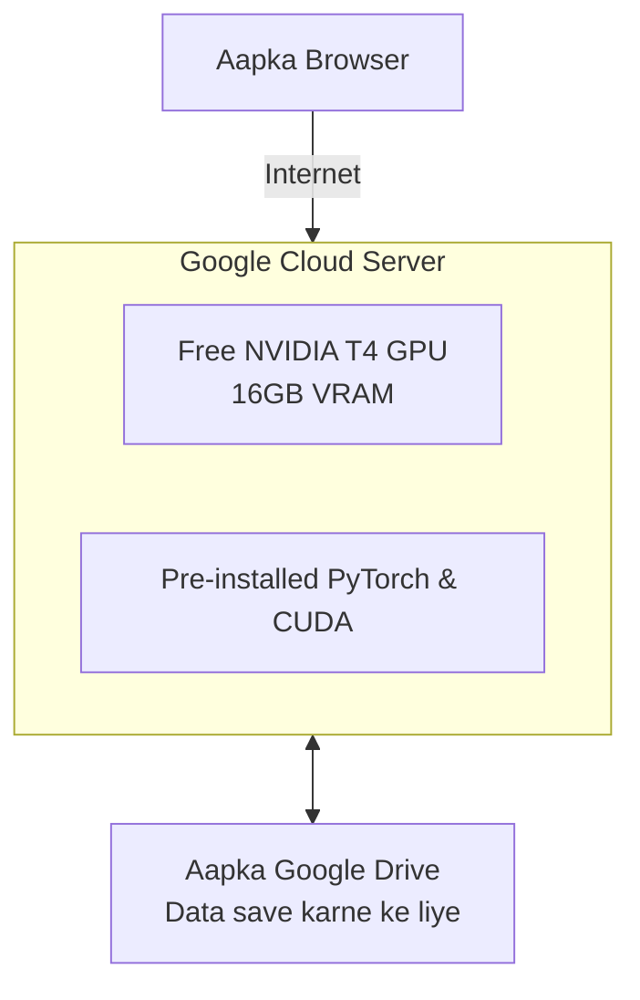

# Submodule 36.08: Google Colab (Cloud GPU Alternative) (Hinglish)

## 1. Google Colab kya hai?

**Google Colab** Google ka ek free cloud-based Jupyter Notebook environment hai (`https://colab.google/`). Iska sabse bada fayda yeh hai ki agar aapke computer mein mahanga NVIDIA graphics card nahi hai, tab bhi aap browser mein Google ke powerful GPUs par free mein deep learning models train kar sakte ho.

---

## 2. Google Colab ke Mukhya Fayde

1. **Zero Installation**: PyTorch, NumPy, Matplotlib sab pehle se installed milte hain.
2. **Free GPU**: Free mein **NVIDIA T4 GPU** (16GB Graphics Memory) milta hai.
3. **Google Drive Sync**: Ek click mein Google Drive connect ho jata hai jisse model save rehta hai.
4. **Direct Sharing**: Google Docs ki tarah ek link se notebook share ho jati hai.

---

## 3. Colab mein GPU Kaise On Karein?

1. `colab.research.google.com` par nayi notebook banayein.
2. Top menu mein **Runtime** $	o$ **Change runtime type** par click karein.
3. **Hardware accelerator** mein **T4 GPU** select karein aur **Save** karein.
4. Cell mein `!nvidia-smi` run karke verify karein.

### Dhyan Rakhne Wali Baatein:
- **Idle Timeout**: Agar 90 minutes tak notebook touch nahi ki, toh disconnect ho jati hai.
- **Temporary Storage**: Notebook band hote hi local files delete ho jati hain, isliye hamesha Google Drive mount karke kaam karein.
