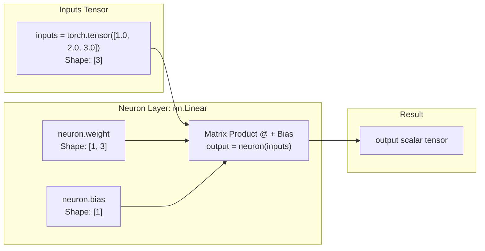

# Submodule 36.09: Building a Neuron in PyTorch (Code Implementation)

## 1. Overview & Computational Graph

In this module, we implement a single artificial neuron from scratch using PyTorch's native `torch.nn` module. We mathematically verify that PyTorch's internal forward pass exactly matches the linear equation:
$$	ext{output} = \mathbf{w}^T \mathbf{x} + b$$



---

## 2. Step-by-Step Code Walkthrough

This code corresponds directly to the lecture demonstration and the accompanying notebook [10_lecture_code_Neuron.ipynb](file:///c:/Users/Shivam%20Keshari/OneDrive/Desktop/AI-ML/lecture_36/Notes_36.09/10_lecture_code_Neuron.ipynb).

### Step 1: Import Core PyTorch Modules
```python
import torch
import torch.nn as nn
```
- `torch`: The fundamental PyTorch package providing multi-dimensional tensor data structures.
- `torch.nn`: The neural network sub-package containing layers, loss functions, and activation functions.

### Step 2: Seed Initialization & Input Tensor Creation
```python
torch.manual_seed(42)
inputs = torch.tensor([1.0, 2.0, 3.0])
```
- `torch.manual_seed(42)`: Fixes the pseudo-random number generator seed to ensure consistent weight initialization across runs.
- `inputs`: A 1D tensor representing 3 input features ($x_1 = 1.0, x_2 = 2.0, x_3 = 3.0$).

### Step 3: Instantiate a Single Artificial Neuron via `nn.Linear`
```python
neuron = nn.Linear(in_features=3, out_features=1)
```
- `in_features=3`: The neuron accepts 3 incoming inputs (requires 3 weights: $w_1, w_2, w_3$).
- `out_features=1`: The layer outputs a single scalar value (1 neuron).
- By default, `nn.Linear` initializes random weights and a learnable bias term ($b$).

### Step 4: Execute the Forward Pass
```python
output = neuron(inputs)
print("Neuron Output:", output)
```

### Step 5: Inspect Parameters & Verify the Mathematical Formula
```python
print("Weights:", neuron.weight)
print("Bias:", neuron.bias)

# Manual verification using PyTorch matrix multiplication operator '@'
manual_verification = neuron.weight @ inputs + neuron.bias
print("Manual Calculation:", manual_verification)
```

---

## 3. Mathematical Proof of Equivalence

Let the random weights initialized by seed 42 be $\mathbf{w} = [w_1, w_2, w_3]$ and bias be $b$:
$$z = w_1(1.0) + w_2(2.0) + w_3(3.0) + b$$
The output generated by `neuron(inputs)` is identical to `neuron.weight @ inputs + neuron.bias` down to machine precision, confirming that an artificial neuron is a parameterized linear transformation.
