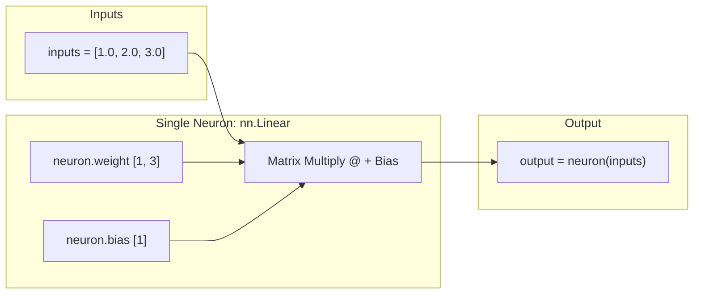

# Submodule 36.09: PyTorch mein Neuron Banana (Code Implementation) (Hinglish)

## 1. PyTorch Neuron ka Concept

Is module mein humne PyTorch ke `torch.nn` package ka use karke ek single artificial neuron create kiya hai aur mathematically verify kiya hai ki PyTorch wahi formula use karta hai jo humne theory mein padha:
$$	ext{output} = \mathbf{w}^T \mathbf{x} + b$$



---

## 2. Step-by-Step Code Walkthrough

Yeh code lecture notebook [10_lecture_code_Neuron.ipynb](file:///c:/Users/Shivam%20Keshari/OneDrive/Desktop/AI-ML/lecture_36/Notes_36.09/10_lecture_code_Neuron.ipynb) se directly liya gaya hai:

### Step 1: Libraries Import Karein
```python
import torch
import torch.nn as nn
```

### Step 2: Seed aur Inputs Banayein
```python
torch.manual_seed(42)
inputs = torch.tensor([1.0, 2.0, 3.0])
```
- `torch.manual_seed(42)`: Random numbers ko fix kar deta hai taaki sabhi ka output same aaye.
- `inputs`: Ek 1D tensor hai jisme 3 features hain ($x_1=1.0, x_2=2.0, x_3=3.0$).

### Step 3: Single Neuron Instantiate Karein
```python
neuron = nn.Linear(in_features=3, out_features=1)
```
- `in_features=3`: Neuron ko 3 inputs mil rahe hain (3 weights honge).
- `out_features=1`: Ek single output generate hoga (1 neuron).

### Step 4: Output Calculate Karein (Forward Pass)
```python
output = neuron(inputs)
print(output)
```

### Step 5: Formula Verify Karein
```python
# Weights aur Bias check karein
print("Weights:", neuron.weight)
print("Bias:", neuron.bias)

# Formula manually check karein: weight @ inputs + bias
check = neuron.weight @ inputs + neuron.bias
print("Manual check:", check)
```
Dono outputs 100% exact match hote hain!

---

## 3. Visual Reference


