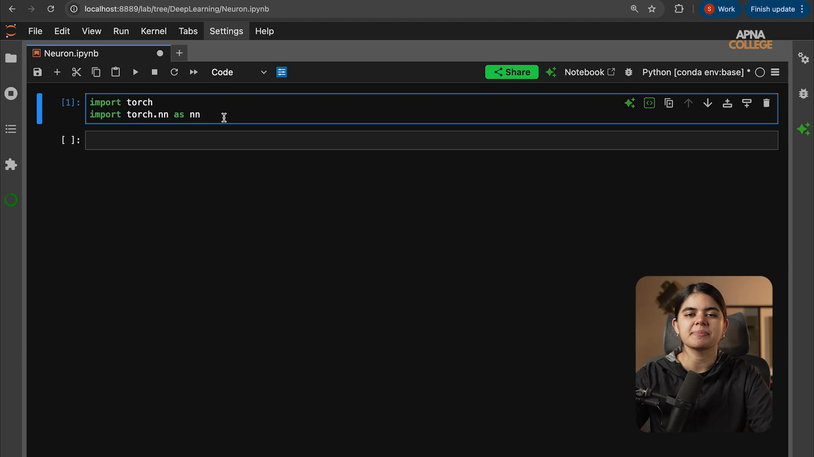

# Submodule 36.10: PyTorch Neuron Interactive Notebook (Hinglish)

## 1. Notebook ka Structure aur File Link

Yeh document lecture notebook ka complete cell-by-cell breakdown provide karta hai:

- **Jupyter Notebook File**: [`10_lecture_code_Neuron.ipynb`](file:///c:/Users/Shivam%20Keshari/OneDrive/Desktop/AI-ML/lecture_36/Notes_36.10/10_lecture_code_Neuron.ipynb)
- **Framework**: PyTorch (`torch`, `torch.nn`)

```mermaid
flowchart TD
    A[Cell 0: Libraries import] --> B[Cell 1: Seed 42 aur inputs [1.0, 2.0, 3.0]]
    B --> C[Cell 2: nn.Linear in=3, out=1]
    C --> D[Cell 3 & 4: Forward Pass output = neuron inputs]
    D --> E[Cell 5 & 6: Formula Proof: weight @ inputs + bias]
```

---

## 2. Har Cell ka Explanation

### Cell 0: Import
```python
import torch
import torch.nn as nn
```
PyTorch aur neural network module ko import kiya gaya.

### Cell 1: Inputs
```python
torch.manual_seed(42)
inputs = torch.tensor([1.0, 2.0, 3.0])
```
3 features ka ek input tensor create kiya gaya.

### Cell 2: Single Neuron Layer
```python
neuron = nn.Linear(in_features=3, out_features=1)
```
Neuron banaya gaya jisme 3 inputs aate hain aur 1 output nikalta hai.

### Cell 3 & 4: Forward Pass
```python
output = neuron(inputs)
output
```
Inputs ko neuron ke andar pass karke output generate kiya gaya.

### Cell 5 & 6: Mathematical Proof
```python
neuron.weight @ inputs + neuron.bias
neuron.bias
```
`@` operator matrix multiplication karta hai. Prove ho gaya ki PyTorch andar wahi $W \cdot X + B$ formula chala raha hai.

---

## 3. Visual Reference


