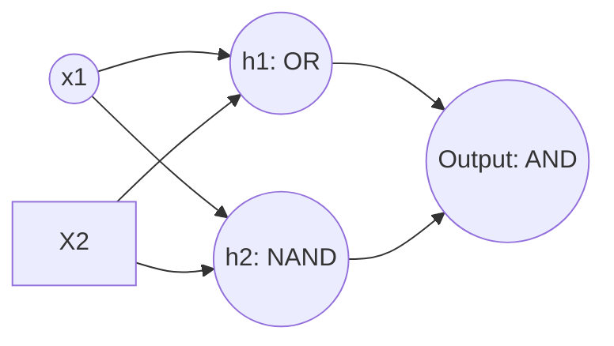

# Solutions: Day 36 Practice Problems

Complete, production-tested mathematical proofs, step-by-step calculations, and PyTorch implementations for Day 36 challenges.

---

## Solution 1: Manual Forward Pass & PyTorch Verification of a Diagnostic Neuron

### 1. Manual Linear Combination ($z$)
The algebraic formula for the net input is:
$$z = w_1 x_1 + w_2 x_2 + w_3 x_3 + w_4 x_4 + b$$

Substituting the given numerical values:
$$z = (0.40 \times 0.60) + (0.70 \times 0.75) + (0.50 \times 0.80) + (-0.60 \times 0.50) + (-0.15)$$
$$z = 0.240 + 0.525 + 0.400 - 0.300 - 0.150$$
$$z = 1.165 - 0.450$$
$$z = 0.7150$$

### 2. Sigmoid Activation Probability ($\hat{y}$)
Applying the Sigmoid non-linear function:
$$\sigma(z) = \frac{1}{1 + e^{-z}} = \frac{1}{1 + e^{-0.7150}}$$
$$e^{-0.7150} \approx 0.48919$$
$$\hat{y} = \frac{1}{1 + 0.48919} = \frac{1}{1.48919} \approx 0.6715$$

- **Decision Triage**: Because $\hat{y} = 0.6715 \ge 0.50$, the neuron classifies the patient as **High Risk (Positive Class 1)** with an estimated default confidence of **67.15%**.

### 3. PyTorch Verification Implementation
```python
import torch
import torch.nn as nn

# Step 1: Define input tensor (shape: [4])
inputs = torch.tensor([0.60, 0.75, 0.80, 0.50], dtype=torch.float32)

# Step 2: Instantiate Linear Layer (4 inputs -> 1 output)
neuron = nn.Linear(in_features=4, out_features=1)

# Step 3: Explicitly assign weights and bias (disabling autograd during assignment)
with torch.no_grad():
    neuron.weight.copy_(torch.tensor([[0.40, 0.70, 0.50, -0.60]]))
    neuron.bias.copy_(torch.tensor([-0.15]))

# Step 4: Execute forward pass
z_torch = neuron(inputs)
y_hat_torch = torch.sigmoid(z_torch)

print(f"PyTorch Linear Sum (z)    : {z_torch.item():.4f}")
print(f"PyTorch Sigmoid Output (y): {y_hat_torch.item():.4f}")

# Assert equality with manual calculations
assert abs(z_torch.item() - 0.7150) < 1e-4
assert abs(y_hat_torch.item() - 0.6715) < 1e-4
print("Verification Success: PyTorch exactly matches manual forward pass!")
```

---

## Solution 2: Non-Linearity & Overcoming the XOR Perceptron Limitation

### 1. Mathematical Impossibility Proof
A single perceptron with step activation predicts $\hat{y} = 1$ if $w_1 x_1 + w_2 x_2 + b \ge 0$, and $\hat{y} = 0$ if $w_1 x_1 + w_2 x_2 + b < 0$.

Applying this to the four XOR truth table points yields four simultaneous inequalities:
1. Point $(0, 0) \to y = 0$:
$$w_1(0) + w_2(0) + b < 0 \implies b < 0 \quad \text{--- (Equation 1)}$$
2. Point $(0, 1) \to y = 1$:
$$w_1(0) + w_2(1) + b \ge 0 \implies w_2 + b \ge 0 \quad \text{--- (Equation 2)}$$
3. Point $(1, 0) \to y = 1$:
$$w_1(1) + w_2(0) + b \ge 0 \implies w_1 + b \ge 0 \quad \text{--- (Equation 3)}$$
4. Point $(1, 1) \to y = 0$:
$$w_1(1) + w_2(1) + b < 0 \implies w_1 + w_2 + b < 0 \quad \text{--- (Equation 4)}$$

#### The Contradiction:
Add Equation (2) and Equation (3) together:
$$(w_1 + b) + (w_2 + b) \ge 0 + 0 \implies w_1 + w_2 + 2b \ge 0$$
Rewrite as:
$$(w_1 + w_2 + b) + b \ge 0$$
From Equation (4), we know that $(w_1 + w_2 + b) < 0$.
From Equation (1), we know that $b < 0$.
The sum of two strictly negative numbers must be strictly negative:
$$(w_1 + w_2 + b) + b < 0$$
This directly contradicts $(w_1 + w_2 + b) + b \ge 0$.
$$\text{Contradiction: A negative number cannot be } \ge 0!$$
Therefore, no set of real weights and biases $(w_1, w_2, b)$ can solve XOR on a single linear neuron.

---

### 2. Multi-Layer Perceptron (MLP) Architecture for XOR
XOR can be decomposed logically as:
$$\text{XOR}(x_1, x_2) = (x_1 \lor x_2) \land \neg(x_1 \land x_2) = \text{OR}(x_1, x_2) \land \text{NAND}(x_1, x_2)$$

We construct a 2-layer network with two hidden neurons ($h_1$ computing OR, $h_2$ computing NAND) feeding an output neuron computing AND:



- **Hidden Neuron 1 (OR Gate)**:
  - Weights: $w_{11} = 1.0, w_{12} = 1.0$, Bias: $b_1 = -0.5$
  - Activation: Step function ($z \ge 0 \implies 1$)
- **Hidden Neuron 2 (NAND Gate)**:
  - Weights: $w_{21} = -1.0, w_{22} = -1.0$, Bias: $b_2 = 1.5$
  - Activation: Step function
- **Output Neuron (AND Gate)**:
  - Weights: $v_1 = 1.0, v_2 = 1.0$, Bias: $b_{\text{out}} = -1.5$
  - Activation: Step function

#### Truth Table Verification:
| $x_1$ | $x_2$ | $h_1 = \text{Step}(x_1 + x_2 - 0.5)$ | $h_2 = \text{Step}(-x_1 - x_2 + 1.5)$ | $\hat{y} = \text{Step}(h_1 + h_2 - 1.5)$ |
| :---: | :---: | :---: | :---: | :---: |
| 0 | 0 | $\text{Step}(-0.5) = 0$ | $\text{Step}(1.5) = 1$ | $\text{Step}(0 + 1 - 1.5) = \text{Step}(-0.5) = \mathbf{0}$ |
| 0 | 1 | $\text{Step}(0.5) = 1$ | $\text{Step}(0.5) = 1$ | $\text{Step}(1 + 1 - 1.5) = \text{Step}(0.5) = \mathbf{1}$ |
| 1 | 0 | $\text{Step}(0.5) = 1$ | $\text{Step}(0.5) = 1$ | $\text{Step}(1 + 1 - 1.5) = \text{Step}(0.5) = \mathbf{1}$ |
| 1 | 1 | $\text{Step}(1.5) = 1$ | $\text{Step}(-0.5) = 0$ | $\text{Step}(1 + 0 - 1.5) = \text{Step}(-0.5) = \mathbf{0}$ |

The 2-layer network solves XOR with 100% accuracy.

---

## Solution 3: Industrial Architecture Sizing & Framework Governance

### 1. Traditional ML Failure Modes at Scale
1. **Curse of Dimensionality in Raw Pixels**: A $1024 \times 1024 \times 3$ image has $3,145,728$ input features. An SVM classifier operating directly on raw pixels requires calculating distance kernels in a 3-million-dimensional space, leading to severe computational explosion and overfitting.
2. **Inability to Learn Invariant Features**: Handcrafted descriptors (SIFT, HOG) rely on rigid heuristics designed by humans. They break down under non-linear lighting variations, rotation, partial occlusion, and micro-defect textures.
3. **Decoupled Pipelines**: Traditional ML separates feature extraction from classification. The feature extractor does not receive error feedback from the classifier. Deep Learning uses end-to-end backpropagation, optimizing feature representations directly for the final loss function.

### 2. Framework Selection Strategy
- **Recommendation**: **PyTorch** for model development and R&D, exported to **ONNX / TensorRT** for edge deployment.
- **Justification**:
  - Developing custom attention mechanisms requires dynamic graphs and intuitive tensor slicing, where PyTorch dominates.
  - PyTorch models can be cleanly exported via `torch.onnx.export()` or TorchScript into NVIDIA TensorRT engines, delivering sub-millisecond inference on NVIDIA Jetson hardware.

### 3. GPU Memory Footprint Calculation
- **Batch Dimensions**: $B = 32$, Channels $C = 3$, Height $H = 1024$, Width $W = 1024$.
- **Total Elements**:
$$\text{Elements} = 32 \times 3 \times 1024 \times 1024 = 100,663,296 \text{ floats}$$
- **Raw Data Size in float32 (4 bytes per float)**:
$$\text{Memory} = 100,663,296 \times 4 \text{ bytes} = 402,653,184 \text{ bytes} \approx \mathbf{402.65 \text{ MB}}$$
- **Why Training Requires 3x to 4x More VRAM**:
  1. **Forward Activations**: Every intermediate hidden layer must cache its forward activation tensors in VRAM so they can be reused during the backward pass.
  2. **Gradients**: For every parameter $W$, an identical tensor of gradients $\nabla_W L$ must be allocated in VRAM.
  3. **Optimizer States**: Optimizers like Adam maintain first-moment ($m_t$) and second-moment ($v_t$) running averages for every parameter, requiring $2 \times \text{Parameter Size}$ additional VRAM.
